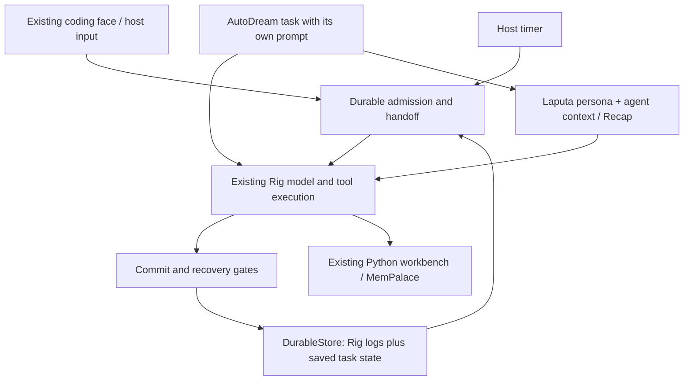

# Decisions and assembly direction

## Plan B: durable execution within the existing Rig chain (owner, 2026-10-31)

**Status: selected architecture direction; the detailed design below remains
proposed except for explicitly accepted decisions, and implementation is pending.**
The owner selects Plan B from the
architecture alternatives. Complete one Vivy core by adding persistent execution
phases, commit boundaries, recovery and sleep/wake behavior within the existing
Rust/Rig execution chain. Validate
through the current coding face. Durable execution is a general agent capability
usable by coding and assistant workloads; their product entry points stay open.

### Alternatives and rationale

| Option | Approach | Decision |
| --- | --- | --- |
| A: task continuation | Preserve task goals/status and wake times around existing execution; interrupted work is suspended and later continued or replanned. | Not selected as the target: fast initial delivery, but coarse continuation alone does not establish phase-level recovery. |
| B: durable execution in the current chain | Reuse Rig's model/tool execution, registration, session and UI facilities; add explicit persistent transitions and recovery control in that chain. | Selected: balance reuse and delivery speed with the required durable guarantees and maintenance cost. |
| C: a Vivy-owned execution loop | Own a new minimal state machine and adapt reusable Rig model/tool capabilities and the coding face to it. | Not selected: greater control, with more execution and UI adaptation to implement and maintain. |

Apply More, Fast, Good, Frugal through direct reuse and a bounded first acceptance
case. These tradeoffs are source-based judgments, not measured delivery times or
performance claims. Do not silently substitute A or C if an integration seam is
insufficient; identify the concrete gap within Plan B first.

### Reference responsibilities

Pi durable is an agent execution runtime designed around persistence: it owns
model/tool work, tasks, checkpoints, recovery, cancellation and durable waits.
It is the semantic reference for this work, not a chat-history saving plugin or
a requirement to import its TypeScript runtime. At inspected Pi revision
`a14cdf90f0a76532f3e20bc3c01872837cef24ba`, the ordinary Pi coding CLI still uses
pi-agent-core; it has no built-in durable-mode switch. See the
[durable reference](https://github.com/earendil-works/pi/blob/a14cdf90f0a76532f3e20bc3c01872837cef24ba/packages/durable/README.md).

Mysoul supplies behavior evidence for committed Recap, explicit bounded recall,
subject-scheduled wakeups and silent outcomes. It does not supply the new Rust
runtime or require copying its LangGraph/SQLite implementation, fatigue model
or fixed activity categories. Laputa remains the persona authority; the agent
owns Recap and task context. Full MemPalace remains the current long-term backend
through the Python workbench. AutoDream uses the shared task infrastructure with
its dedicated Dream prompt and validated automatic adoption, preserving its
separate execution context and declared version-activation boundary.

### Required execution boundary

- Persist admitted input and task identity; retries must not admit the same
  request twice. Keep task/checkpoint state separate from narrative Recap.
- Preserve model results and tool intents before dependent work starts. Commit
  tool results before allowing later steps to rely on them. Define one
  authoritative commit boundary for related records; independently written
  status and transcript files cannot both claim the transition is complete.
- Recover from committed phases. Reuse confirmed results; rerun interrupted
  calls only under an explicit replay-safe policy. Preserve uncertain external
  outcomes rather than blindly retrying shell, Python, MCP or message sends.
- Separate stopping a waiter from cancelling work. Persist cancellation state
  so stale completions cannot advance cancelled or superseded work. Preserve
  the accepted single-tool handoff boundary and human immediate interruption;
  multiple pending tool calls need valid call/result pairing.
- Persist sleep deadlines and resume positions. A live host timer or host wakeup
  remains necessary. Waking gives the agent a decision opportunity; speaking is
  optional. Do not add a model call merely to advance every mechanical step.
- Keep JSON/JSONL as the storage direction, with commit framing, sync, ownership
  and recovery details to design. Python namespaces remain ephemeral across
  worker restart; explicit artifacts survive and arbitrary cells do not replay
  automatically. Memory-engine internals retain their own storage authority.

Rig at recipe revision `e1cd47d57f0bccb50ddffd6f45de2ac3365b271c` already exposes
execution stages, interrupted-call recovery and a replaceable store. Its
`rig-ecs/src/stage.rs` writes changing-tool intent before dispatch, but explicitly
does not sync that write to disk; `rig-memory/src/writer.rs` flushes logs
separately. These are useful seams, not proof of the selected durable contract.
First verify control of tool start, result publication, recovery and next-step
dispatch, including storage failure and cancellation, before broad rollout.

The first acceptance slice is a model/tool task exercised through the current
coding face, interrupted at selected phases and reopened: confirmed results are
retained, uncertain actions are reported, and stale results cannot advance work.
Then integrate persona/Recap/recall and a recoverable wakeup; AutoDream reuses the
verified infrastructure. The proposal below details the state, storage and
context contracts; exact APIs and implementation steps remain engineering work.
This decision delivers no code or new runtime evidence and does not close
deferred real-provider checks.
The official inbox, general DAG/distributed scheduling and product navigation
are not prerequisites for the first slice; existing scope exclusions remain.

### Recap ownership and Rig reuse (owner, 2026-10-31)

**Status: accepted responsibility split and reuse direction; implementation is
pending.** Reuse Rig's conversation summarization infrastructure for Recap.
Rust owns the effective context and Recap publication/recovery; the Python
workbench owns existing long-term memory integration and may assist with
content preparation. Mysoul remains the behavioral reference.

| Responsibility | Owner and selected approach |
| --- | --- |
| Context composition, budgets and tool-call/result pairing | Rust / Rig, reusing existing conversation and compaction mechanisms |
| Effective Recap, source coverage and publication/recovery | Rust, preferring Rig's existing saved-state and conversation facilities |
| Summary content, update triggers and recent-message retention | Small Vivy policy extensions over Rig; no second execution loop |
| Long-term memory search/write, source cleaning and batch organization | Existing Python workbench / MemPalace |
| Optional complex experience analysis and AutoDream material preparation | Python where useful; adopted state still passes through its authoritative owner |

The current recipe already selects `rig_basics::compaction::CompactionPlugin`.
At recipe pin `e1cd47d57f0bccb50ddffd6f45de2ac3365b271c`, Rig provides
`SummaryState`, `Summarizer`, configurable summary prompts and recent-message
retention, tool-pair-aware cuts, and logged summary replacement with undo.
Summary model calls participate in the existing cancellation/retry chain.
These facilities also exist at inspected upstream main
`fc556f982d501eea9d7167398a19386e4884e776`. See the pinned
[summary primitives](https://github.com/0xPlaygrounds/rig/blob/e1cd47d57f0bccb50ddffd6f45de2ac3365b271c/crates/rig-memory/src/compaction.rs),
[compaction plugin](https://github.com/0xPlaygrounds/rig/blob/e1cd47d57f0bccb50ddffd6f45de2ac3365b271c/plugins/rig-basics/src/compaction.rs)
and our existing [branch-summary reuse](../plugins/vivy-basics/src/branch.rs).

Rig's default compaction keeps a conversation within the model window. It does
not by itself establish a persistent subject's Recap policy, cross-session
continuity or the stronger durable commit guarantees required above. Begin by
adapting summary prompts and retention policy, then add the necessary assistant
update triggers and source/publication checks in the same execution chain.
The exact trigger, Recap-only versus a bounded not-yet-summarized conversation
tail, and any cross-session subject projection remain design choices.

Do not outsource the complete context authority to Python or introduce a
parallel Recap database. If a demonstrated need calls for Python-generated
summary candidates, Rust checks their source revision/coverage before adopting
them. That bridge is optional, not a prerequisite for the first slice. Python
variables are ephemeral across worker restart; existing MemPalace storage stays
authoritative for long-term memory. Laputa's native persona authority and
AutoDream's separate context and automatic validated adoption remain unchanged.

This records source inspection and an owner decision, not new runtime tests,
implemented assistant Recap, a dependency upgrade or a measured cost reduction.

### Detailed architecture proposal (2026-10-31)

The owner requested detailed design after selecting B. The requirements above
are accepted; the concrete contracts below are engineering proposals, not new
owner rulings or implemented guarantees. The goal is one recoverable execution
chain through the current coding face, followed by context/memory, wake and
evolution integration. Product navigation remains outside this design.

**Upstream adoption amendment (2026-10-31).** The owner emphasizes direct Rig
reuse and contributing generic fixes to avoid downstream divergence. The
[current upstream assessment](research/2026-10-27-session-storage.md#current-upstream-adoption-assessment-2026-10-31)
finds a new public `CarryOn` continuation policy and existing saved-state,
recovery, timer and corpus examples. Prefer these public primitives and bounded
upstream improvements before implementing Vivy-owned equivalents. This refines
Plan B's implementation ownership, not its required guarantees. The custom
framed `DurableStore` described below is now a conditional fallback, not the
default first build task. D0 first verifies reuse and concrete missing guarantees
on a deliberately selected Rig revision. Latest upstream is not yet our tested
dependency: its default is to stop restored turns unless a plugin opts in;
Vivy must restore its continuation policy explicitly. No pin upgrade or upstream
contribution is delivered by this amendment.

#### 1. Composition and ownership

Keep Rig's existing agent loop, model adapters, tool registry, conversation
format and host. Add one repository-owned `plugins/vivy-durable` crate with a
`DurablePlugin`; initially keep its state, store, scheduling and Rig bindings as
modules in that crate. A later small `vivy-laputa` plugin owns native persona
operations. Extend `vivy-python` only where the existing workbench needs stable
task identities or typed memory operations. No new provider stack, task service,
plugin SDK or TypeScript runtime is required.



The YAML recipe selects these compiled capabilities. A recipe without durable
support continues using the existing execution chain with its existing storage
contract. Settings configure selected capabilities, such as wake budgets; they
do not replace compile-time selection. The first durable recipe reuses the
coding face and tools. This is not a second assistant engine or a product-mode
switch. Kernel persistence can work without Python or a memory backend.

| Owner | Authority |
| --- | --- |
| Rig | Model/tool execution, tool registry, conversation semantics and existing host services |
| Durable plugin | Admitted tasks, durable phase transitions, replay decisions, cancellation generations, wake records and commit gates |
| Laputa plugin | One workspace persona source and controlled versioned updates |
| Agent context code | Context composition, Recap, evidence budgets and compaction policy |
| Python workbench / MemPalace | Worker resources and canonical long-term memory storage |
| AutoDream workflow | Collection, candidate generation, validation and automatic adoption through the owners above |

#### 2. Identity, state and the minimum control surface

Use the persisted Rig agent ID scoped by session ID as `AgentKey`; an ECS
`Entity` is only a live binding. Generate persistent `TaskId`, `InputId` and
`WakeId` values at admission. An `OperationId` is `(TaskId, step, attempt)`;
retain Rig tool-call/message IDs as mappings, not as substitutes for task
identity. A retry has a new attempt while retaining the original logical step.
Sessions created by fork receive fresh execution identities and no live timers.

One `DurableAgentState` saved component under a stable schema key carries the
agent's task records, ordered pending inputs, wake records and control revision.
Use Rig's `ReflectSaved` mechanism with a stable `SavedKeys` name rather than
depending on Rust type-path names on disk. Every state transition increments
`state_revision`. An input retry with the same source/request key and identical
payload returns the original task/receipt; changed payload is a conflict.
Persist the deduplication data; process-local maps are insufficient.

| Record | Minimum durable fields |
| --- | --- |
| Task | ID, agent, admitted input, parent if any, status, current step, generation, outcome/error, context references |
| Operation | ID, Rig call mapping, kind, frozen request or argument reference, handler identity/version, replay policy, phase, result/error reference |
| Input | ID, source/request key, payload digest and content/reference, target, arrival order, disposition |
| Wake | ID, target task or agent, deadline in UTC, generation, reason, pending/fired/cancelled state |
| Context reference | Persona revision, Recap revision, conversation boundary and immutable evidence references used by a model operation |

Task statuses are `queued`, `running`, `waiting`, `suspended`, `completed`,
`failed`, `cancelled`. Waiting means a saved deadline or an explicit dependency;
suspended means a decision or reconciliation is required. An operation is
`prepared`, `dispatched`, `settled`, `unknown` or `not_run`. An unknown external
outcome is not a successful result or proof that the operation did nothing.
Narrative Recap never substitutes for these fields.

Internal Rust operations are `submit`, `cancel`, `schedule_wake`, `resolve` and
`inspect`; names are provisional, and there is no generic public service API.
The coding face uses these operations instead of admitting input outside the
durable gate. An agent-facing `task_control` tool offers bounded actions:
continue the active task, switch to an admitted task, defer a task, arrange a
wake, or finish silently. It returns typed control records with expected task
generation; arbitrary text is not parsed as a state transition. Ordinary final
answers still finish through Rig's normal path. Requesting user input suspends
the relevant task until a corresponding input is admitted.
Control tools propose transitions; the host applies them after committing the
control call's own result, so switching or finishing cannot orphan that call.
Switch/defer/finish also close every unstarted sibling call with `not_run`,
commit that complete batch, and only then change the active task or end its
turn. They obey the same closed-batch rule as incoming-input handoff below.

One foreground decision runs per agent. The initial durable path serializes
that agent's tools in model-declared order. Existing parallel subagents remain
separate agents; recoverable parent/child joins are a later acceptance slice,
not an excuse to label existing in-memory delegation durable. Unsupported
delegation in the first durable slice must fail before dispatch with a clear
reason. Existing non-durable recipe behavior is preserved.

#### 3. Storage and the actual commit unit

Reuse Rig's logical logs and saved components. First evaluate Rig's store and
small upstream extensions against the required commit contract. If a separate
`DurableStore` is still justified, the fallback design below places it behind
`StoreOpener`, without a parallel task database. Each task checkpoint and
the exact data needed to resume it must reside in the same **agent-log append**.
Session listing metadata is derived. No invariant in the first slice requires
an atomic write across an agent log, another agent log and the session log.
Later joins refer to an already committed child's result before committing the
parent's acceptance; an interrupted join is reconciled by identity.

Proposed physical layout inside a newly created durable session:

```text
durable/format.json       # format/schema identity, created before use
durable/writer.lock       # OS-held exclusive writer ownership
durable/journal.jsonl     # authoritative framed Store operations
files/blobs/...           # immutable, content-addressed referenced data
```

The journal implements Rig's logical log reads/appends/replacements. Each
newline-terminated frame contains a versioned payload (sequence, operation,
logical log, expected byte length, exact new log bytes) and a checksum of the
exact payload bytes. A Rig append containing multiple JSONL records becomes
one outer frame. A replacement is one frame as well; no in-place truncation of
the committed logical log. Preserve `Store`'s expected-length conflict behavior
and `Files` atomic-replacement contract. Do not buffer a successful Store call
and pretend it has already produced a durable receipt.

After writing a complete frame, synchronize the journal to the OS durability
boundary before returning success. A receipt identifies the log's committed
length, state revision when present, and journal sequence. Publish the new
read view only after this succeeds. Referenced immutable blobs are written and
synced before the referencing frame. On open, verify framing, checksums,
sequence and expected lengths, then expose only the valid committed prefix to
Rig. Set aside a final incomplete frame under writer ownership; interior
corruption or a complete frame with an invalid checksum fails closed.
A valid frame whose acknowledgement was lost may be present on reopen; callers
reconcile stable IDs instead of assuming a reported write error means no commit.

Store provider authentication as existing credential references, never resolved
tokens. Frozen logical requests exclude transport credentials; tool adapters
resolve admitted secret references only at dispatch. Known credential literals
must not enter task checkpoints or collected evolution evidence. A call that
cannot retain a safe, sufficient replay representation remains non-replayable.
Session contents are private local runtime data, excluded from version control.

Use one process writer per session and a process-local mutex for Store calls.
An OS lock must reject a second writer and release on process death; a PID file
alone is insufficient. Any append/sync failure poisons the live session for new
execution until it is reopened and reconciled. Preserve the original cause.
Session listing readers use derived metadata or a consistent committed view.
This is local storage, without distributed locks or network-filesystem claims.

This design requests synced commits, but process-kill tests do not certify
power-loss durability. File creation, replacement and directory metadata
durability need a Windows-specific implementation and evidence. State the
tested filesystem/platform limits. Start with whole-log reads as Rig already
uses; measure journal growth, reopen time and sync cost before adding snapshots,
segmentation, background compaction or group commit. No per-token disk sync.

#### 4. Binding persistence to Rig execution

The binding uses holds and receipts around Rig's loop. It does not implement
another model/tool loop. A gate's permission applies only to an exact operation,
request digest, generation and committed revision. Changed requests lose that
permission and require a new checkpoint.

1. **Admit.** Hold incoming work, save its input, deduplication key and task
   state, then release only after the receipt. Input shown as pending in the
   terminal is not yet an admission acknowledgement.
2. **Prepare execution.** After request composition/routing, freeze the model
   request or tool arguments and context references. Save dispatch intent and
   replay policy with the task state. Hold the call until that state revision
   has a receipt. Persist intent for read-only calls too.
3. **Start.** Recheck generation and cancellation at dispatch. Rig invokes its
   existing handler once the gate releases. A committed intent followed by a
   crash can mean the call never actually started; an unsafe call is still
   treated as potentially executed.
4. **Receive result.** Review/redact the final outcome, store the exact result
   needed for replay plus the task transition, and hold settlement until its
   receipt. A transient ECS outcome or visible stream is not the commit.
5. **Publish and continue.** Release the result for Rig's conversation update.
   Before the next operation starts, require a checkpoint that includes that
   conversation change, the task's next phase and required result references.
   Then release the next gate. A final task completion also waits for its
   receipt before the UI reports durable completion.

Steps 4 and 5 deliberately allow a durable result to precede its transcript
projection. The saved result is authoritative; restart can finish publication
without rerunning the effect. Do not declare completion based on two unrelated
files or two independently updated copies of task status. Stream deltas may
appear provisionally; a terminal completion indicator requires committed state.
Local UI display is not an exactly-once external-message-delivery guarantee.

The intended scheduling seam is to retain holds through the current AgentPass,
update saved components before `Last/SaveSystems`, let `Last/WriteLogs` flush,
check receipts after `WriteLogs`, and release only in a later frame. The Store
must inspect the appended stable state key and conversation boundary, not merely
report that *some* append succeeded. `ConversationChanged` is a queued-change
notification and `SessionLog::has_written` is not a checkpoint receipt.

| Pinned Rig seam inspected | Integration requirement still to prove |
| --- | --- |
| `PrepareSystems`, `Stage::Gate`, `HoldOf`, `Decision` | Freeze the final effective request and prevent all dispatch, including successor/retry calls, before the receipt |
| `ReviewSystems::{Edit,Act}`, result/turn holds | Capture the final redacted outcome and prevent settlement, final-answer completion and later work until committed |
| `ReflectSaved`, `SaveSystems`, `WriteLogs` | Task state and required conversation changes reach the same agent-log append; serialization failure cannot look like success |
| `StoreOpener::new`, `Store` | Install the framed store for new/opened sessions, preserve store contracts, expose precise receipts and writer ownership |
| `Interrupted::{Started,Settled}` and `Restored` | Rebind stable operation IDs, restore saved model/tool outcomes, and hold recovery before default fallback or automatic continuation |
| `StopTurn` and Python worker stop | Persist cancellation, fence late completions and clean owned resources without relying on an unsaved observer order |

These are source-inspected opportunities, not successful integration tests.
At pinned Rig `e1cd47d57f0bccb50ddffd6f45de2ac3365b271c`, `SessionLog::flush`
and conversation draining are crate-private; saved components normally flush in
`Last`. The kernel can advance multiple passes in one frame. It also redacts
results when entering Commit after plugin Review, so the capture point must
use the same redaction policy and prove no later mutation bypasses the saved
digest. A Store wrapper alone cannot establish all these guarantees.
If public holds/orderings cannot satisfy a required seam, report the exact
missing hook and propose a bounded Rig API extension with a deliberate pin
update. Do not mutate the reference checkout, copy the kernel, or replace B
with task-only continuation. The first implementation slice must settle this
before the rest of the design is advertised as feasible on the current pin.

#### 5. Recovery, replay and cancellation

On open: acquire ownership, validate the storage and required state schemas,
restore committed logs/state, rebind IDs, reconcile operations, then admit new
execution. Incompatible or missing durable state is an open failure, not a
default empty task component. Verify the recipe has the required compiled
capabilities and the workspace identity still matches; missing tools/providers
suspend affected tasks with an actionable cause.

| Last committed condition | Recovery action |
| --- | --- |
| Input/task queued; no dispatch intent | Resume admission once, using the existing task ID |
| Model intent without committed result | Start a new recorded attempt under a bounded retry policy using the frozen logical input; interrupted stream is provisional |
| Tool intent without committed result | Replay only when both recorded and current handler contracts permit it; otherwise mark unknown and suspend dependent work |
| Result saved; transcript not yet published | Supply the saved outcome to Rig and finish publication, with no external call |
| Result and next checkpoint saved | Continue from that checkpoint and reuse prior results |
| Cancel requested or generation superseded | Reconcile late outcomes, finish cleanup, and never dispatch the old continuation |
| Waiting with deadline | Re-arm the host timer or enqueue the overdue wake once |

Default tool replay is unsafe. A read-only declaration alone is not a replay
contract: credentials, remote state and handler versions may change. Explicitly
safe handlers may be retried under their recorded policy and current permission;
idempotent handlers require a stable external idempotency key or a verifiable
receipt. Model retries may incur another request/charge and produce a different
answer; internal thoughts or an interrupted token stream are not resumed.
Persist attempt counts and backoff deadlines; the initial model budget is one
recovery retry before suspension, configurable without weakening tool policy.

Unknown effects may be resolved by reading an authoritative external receipt,
checking their actual result, or obtaining a user decision. The agent may
perform non-mutating reconciliation; it must not silently resend the original
effect. Preserve the original unknown record alongside the resolution evidence.
Failures known to occur before dispatch and failures with uncertain side effects
must be different structured outcomes.

Before model-assisted reconciliation, publish an explicit uncertainty result
for the original provider tool-call ID and `not_run` results for its unstarted
siblings, then commit the closed batch. The original operation remains `unknown`
in task state even though its transcript call now has a result. A new model
operation on the same agent, with purpose `reconcile`, may use only admitted
non-mutating inspection tools and typed resolution/control actions; dependent
mutating work stays suspended. Resolution saves evidence and the chosen outcome
before normal execution resumes. A user may instead abandon the task while
retaining the unresolved operation. No new call is presented as the old call's
successful replay.

Cancellation first prevents further dispatch and requests immediate termination
of owned live work; it then persists the cancellation generation and outcome.
Only the durable receipt acknowledges a saved cancellation. If storage fails,
stop locally, report cancellation as unsaved, and require reconciliation on
reopen. No protocol can promise a cancel survived a crash before being stored.
Reject late results as continuations by `(TaskId, generation, OperationId)`,
while retaining evidence of an external effect that actually finished. Cancelling
a UI waiter or closing a view does not cancel a task. In this first local host,
exiting the process checkpoints/suspends tasks and stops owned workers; it is
not a promise that they keep executing without a host.

#### 6. Single-tool handoff and new input

Persist incoming messages while the current operation runs. With no pending
input, complete the normal next step. With pending input, stop dispatching sibling
calls after the current tool result commits and give the agent the pending
input and saved task state. If input arrives during model generation, admit it
at the next committed model boundary before starting new tools. Idle agents can
decide immediately. No model call is needed merely to acknowledge a receipt.

To keep provider transcripts valid when a reply requested several tools, commit
explicit `not_run` results for the siblings that have not started before the
handoff decision call. Their reason is yielding to new input, not tool failure.
Those call IDs are closed; continuing the old plan requires freshly issued calls
after the agent's decision. Do not resume a closed call ID or insert a new model
turn into an unresolved tool-call batch. The initial per-agent serialization
avoids pretending that an already running sibling can be undone.

The agent chooses continue, switch, defer, ask the user, or finish. An explicit
human immediate-interruption command follows the cancellation path above.
The pending-input records are the minimum execution queue; the deferred official
inbox, hook subscriptions, mail browsing and external channel adapters are not
implemented by this queue. Later hooks submit the same typed inputs.

#### 7. Persona, Recap and memory integration

Proposed native persona storage is one versioned workspace `persona.json`, with
`schema_version`, `persona_id`, `revision`, `text`, `last_update_id` and source
references. Laputa exposes read and compare-and-swap update operations. Updates
validate the expected revision, write/sync a replacement, then atomically publish
it under an OS writer lock. An interrupted update is reconciled by update ID and
revision. Tasks record the observed revision, not a second mutable persona copy.
The exact bytes used by an in-flight model request are part of its checkpoint.

The model composer puts the persona block at the application's top-level
persona position, with host/tool rules and project context explicitly composed.
Existing trusted `SYSTEM.md` customization needs one defined composition point;
it must not silently create another persona authority. Persona activates at the
next *new* model operation, never halfway through a request. A retry of an old
operation uses its pinned context; deliberate replanning creates a new step.
AutoDream uses its separate Dream prompt without the conversational persona.

The accepted [Recap reuse decision](#recap-ownership-and-rig-reuse-owner-2026-10-31)
governs implementation ownership here. The proposed Recap metadata is agent-owned
saved state: revision, covered conversation boundary, summary, current goal and
evidence references, reusing Rig facilities rather than creating a parallel store.
Update it only against the
expected source boundary; discard/recompute a stale candidate. Preserve current
tool-call/result pairs until closed. Keep the existing coding context/compaction
policy as the initial policy. The mysoul-inspired compact policy can later use
persona + committed Recap + active task + bounded selected evidence. These
policies share an execution engine and must not create two Recap authorities.

Keep MemPalace's existing `remember/get/search` API. Start with explicit bounded
recall and explicit useful memory writes; neither every token nor every turn
requires retrieval. A typed workbench memory operation may wrap the existing
facade when recovery needs stable arguments; arbitrary Python cells remain
unsafe to replay. Use stable workspace/source and task/event keys for writes,
and reconcile with `get(source_id, event_id)` after interruption. Same-key
different-content conflicts and incomplete chunk records require resolution;
the existing facade already exposes these cases. Do not turn all memory failures
into automatic retries. Corrections use new events with source references.

Memory ingestion can be a small follow-up task: its failure leaves ingestion
pending without undoing a successfully completed coding task. MemPalace remains
its own storage authority; there is no distributed transaction with the task
journal and no mirrored memory database. A source ID or partition is not an ACL.
Worker restart creates a fresh Python namespace and reconnects admitted resources;
stable artifacts and memory survive, live Python variables do not. Durable
bindings must not fall back to `Entity` or the string `unsaved` as storage IDs.

#### 8. Sleep, wake and host lifetime

Save a one-shot wake with its task transition to `waiting`. The local host arms
one timer for the earliest deadline and rechecks persisted generations on fire.
Committing `WakeFired` and its queued input occurs in the same agent checkpoint.
Repeated timer callbacks use the wake ID as the input deduplication key. The wake
decision may act, ask, reschedule, or finish silently; no user-visible message is
required. If the agent is busy, the wake waits for the normal handoff boundary.

On startup, enqueue each still-valid overdue one-shot wake once. Replacing or
cancelling a schedule changes its generation so an old timer cannot revive it.
Use stored UTC deadlines and recheck wall time after monotonic waits; no cron,
catch-up burst or distributed scheduling in the first slice. Self-scheduled
wakeups have a host-configured minimum delay and per-task action/model budget.
Exhaustion suspends autonomous work with a recorded reason.

The host must remain running for an on-time wake. A stopped computer/process
executes overdue work only after restart. A background service, detached daemon,
OS boot scheduling and reattachment UI are later deployment choices. Persistent
state, an available host and a continuously running model are distinct concerns.

#### 9. Evolution on the same infrastructure

After execution/context/wake acceptance, AutoDream runs as a task with a distinct
agent context and Dream prompt. A bounded collection task writes immutable
source references and selected evidence into its dedicated workspace. Source
events, candidates, validation results and adoption receipts remain distinguishable;
do not collect recalled material again as fresh experience by default.

The first evolution slice handles persona candidates and reusable textual
lessons. Candidates name base revisions and evidence. Validate schema, scope,
size, applicability and preservation of required constraints, then automatically
apply valid candidates through Laputa or the memory owner. Reject or regenerate
stale candidates. Routine per-candidate human approval is not an activation gate.
Task records retain the effective revision and failure reason. Persona rollback
is a new checked revision, not history deletion. Mixed-backend adoptions are
separate recorded operations, not an invented atomic update across all stores.
Executable Skill candidates require their own validation before later inclusion;
the initial textual slice is not proof of general self-modifying-code safety or
of measured improvement in agent quality.

#### 10. Compatibility, acceptance and remaining engineering choices

New durable sessions are the first target. Keep existing sessions readable in
their existing format; do not auto-convert active sessions. A later explicit
import can seed a durable session from a completed conversation without claiming
that past effects have recoverable execution records. A durable-format session
opened without compiled durable support must fail clearly, including through
the launcher's and coding face's resume paths; it must never look like an empty
legacy session. Fork/rewind must create a new execution lineage with no copied
pending task, cancellation generation or wake. Until this is verified, refuse
those mutations for durable sessions before changing data. Context compaction
must preserve the task checkpoints and required active call pairs.

| Slice | Acceptance evidence |
| --- | --- |
| D0: Rig binding and store | One model/tool task through the coding face; observe holds/receipts at actual pinned integration points; reject an incompatible resume and a second writer; retain legacy recipe behavior |
| D1: execution recovery | Kill before/after intent, after external effect but before result, after result commit but before publication, and after final commit; prove reuse, unknown outcomes, admission deduplication and no duplicate unsafe call |
| D1: control/failure | Inject append/sync/serialization errors, torn tail and corruption; cancel with late results; introduce new input between two requested tools; inspect valid tool-call/result pairing and worker cleanup |
| D2: context and memory | Inspect actual model requests for persona revisions and Recap coverage; restart and recall written evidence; reconcile a repeated/incomplete memory write and a missing Python namespace |
| D3: wake | Restart before/after a deadline, duplicate callback, replace/cancel deadline, wake while busy, silent outcome and exhausted budget |
| D4: evolution | Evidence collected once, candidate validated, automatic adoption recorded, next new request uses the adopted version, stale update rejected and rollback exercised |

D1-D3 form the first persistent-agent infrastructure loop. D4 closes the agreed
learning/evolution loop. Use synthetic data and deterministic offline models
for failure injection, then the existing coding face with a configured real
provider for the joint path. The prior workbench real-provider acceptance is
still deferred; source inspection and scripted gateways do not close it. Add
focused checks as each behavior is implemented, without making every later
integration a prerequisite for D0.

Before implementation, the builder must verify the D0 seams, choose exact
serialization/helper libraries compatible with the pinned Rust toolchain, and
specify bounded payload/queue/budget defaults with errors. Those are engineering
choices within this proposal. API naming, module splits and future indexing are
not user-facing architectural decisions. The source-level risks still requiring
proof are receipt-aware scheduling, final-outcome capture after redaction,
model-result recovery, cancellation ordering, and durable-format detection in
all resume paths. This document delivers design only; no Rust implementation,
crash test, performance measurement or new provider verification accompanies it.

## Single Vivy core and infrastructure-first decision (owner, 2026-10-31)

**Status: accepted direction.** The technical foundation is one Vivy core.
The immediate priority is completing agent infrastructure and validating it
through the existing **coding face**, the current user-facing coding interface.
This supersedes any reading of the earlier two-harness discussion as a decision
to build separate underlying engines or to require a new product interface
before validating persistent-agent capabilities.

Extend the current Rust foundation and reuse its working components. Keep
workload-specific context, task ownership, recovery and cancellation contracts
explicit within the shared infrastructure. Pi durable remains the lifecycle
reference; mysoul supplies basic-loop evidence. Laputa persona governance,
agent-owned Recap, the current full MemPalace backend and AutoDream retain their
accepted responsibilities. YAML recipes continue to select compiled components.
Concrete implementation details and bounded acceptance cases are engineering
work within this direction; the single-core choice is settled.

Use the current coding face to exercise actual model/tool execution and the
infrastructure being added, including persistence, task recovery, context,
persona and memory integration. Record representative failure and cancellation
behavior as those capabilities change. Existing coding success alone does not
establish the new durable guarantees, and this decision does not retroactively
pass the deferred workbench real-provider gate.

**Product form and navigation remain undecided and outside the immediate work.**
This includes a unified role entry at the top of the session menu, its relation
to independent coding sessions, an assistant-first delegation experience, and
Diva's desktop/pet/integration-bundle packaging. The owner explicitly parked
these questions after the initial discussion; do not record that discussion as
an approved UI or product architecture. No old Vivy or Diva checkout inspection
or migration is needed for this work.

This is a decision record, not a delivered infrastructure implementation. The
official inbox remains scheduled for a later phase. Next work should identify
the infrastructure gaps and close a bounded, testable loop through the current
coding face, without making product-shape decisions its prerequisite.

## Laputa protocol and Garden governance decision (owner, 2026-10-31)

**Status: accepted architecture direction; implementation pending.** Apply
More, Fast, Good, Frugal by reusing the host's persona, working context and memory
facilities. Laputa becomes a specification/protocol for persona and memory
governance with small host-specific implementations. An independent Laputa
library, Garden server or complete memory runtime is not a universal prerequisite.
This supersedes older assumptions that Laputa must own ACTMEM, that persona must
be stored in Prime harness entries, or that Vivy must consume Garden through the
old Go MemoryPort/REST design.

### Ownership in the new Vivy

| Concern | Selected responsibility |
| --- | --- |
| Persona | The Vivy-side Laputa implementation manages one authoritative persona source, exposes controlled read/update operations, and supplies the persona layer of model context. |
| Persona injection | Persona is the root persona block in the application's top-level prompt composition. The actual host assembles the request; storing data or editing a file alone does not prove the model received it. Exact fields, format, size and refresh boundary remain open. |
| Short-term Recap / ACTMEM | The agent/harness owns its working-context engine, persistence and compaction. Laputa describes the ownership/integration boundary; it does not introduce a second Recap engine or require Garden's ACTMEM file. Coding and durable retain their separate context policies. |
| Long-term memory | The current implementation remains the full Python-native MemPalace integration. The architecture should permit a later replacement backend, such as Mem0, without moving persona or task-state authority into that backend. No replacement adapter or data migration is selected now. |
| Evolution | Vivy's AutoDream closes its own collection-to-adoption workflow. Reusable Garden workflows may serve other hosts; running Garden is not a prerequisite for Vivy evolution. |

A small Rust implementation is the preferred Vivy integration direction for
persona reads, updates and prompt composition. The protocol does not prescribe
Rust for other hosts, and the exact Rust crate/API is not selected. Dedicated
workflows such as AutoDream retain their persona-free Dream prompt. Persona data
changes are runtime data updates; selecting new compiled components still follows
the YAML recipe and rebuild. Do not inject MemPalace L0 as another identity source.
MemPalace's partition vocabulary remains useful within that backend, not a
mandatory schema for all future memory engines.

Backend interchangeability is an architectural boundary, not a claim of equal
features or automatic data portability. Select the smallest interface needed by
real consumers and report unsupported operations honestly. Keep canonical memory
writes and engine-specific storage inside the selected backend. A working
workspace can hold source materials and evolution artifacts without becoming a
second authoritative copy of all long-term memory.

### Garden as a reusable governance workflow

Garden remains useful as an optional workflow/management application for agents
without Vivy's integration, with Hermes and OpenClaw as owner-named examples.
Adapt to each host's existing persona files, memory facilities and native
evolution path. Update the host's existing authoritative files or supported write
API rather than maintaining parallel Laputa persona files. File names, native
reload behavior and available evolution hooks require adapter-specific inspection;
this decision does not certify those integrations.

The required closed loop is: collect corpus/evidence in an explicit workspace;
invoke a selected agent to produce updates; apply them through the owning host's
write policy; verify which changes became effective; retain outcomes usable by a
later run. Candidate generation alone is not completion. Vivy's existing
AutoDream decision retains automatic adoption without routine human approval of
each candidate. Other hosts keep their own update and approval policies; the
protocol does not impose one universal Persona review workflow.

Do not add a competing scheduler or evolution writer when the host already owns
one. The workflow can reuse or coordinate that native path. A unified Web console
and future Garden management of Vivy's internal Laputa are possible extensions
for later discussion, not selected remote-management transports or current gates.
Exact protocol messages, persona representation, update/conflict/history rules,
backend interfaces and workflow packaging remain detailed design work.

The same owner direction is recorded in the local Garden/Laputa project's
`docs/architecture/0016-laputa-protocol-and-native-agent-governance.md`.
No original Vivy checkout/data is needed. This is a documentation-only checkpoint;
it does not deliver Laputa/Garden adapters, change the deferred workbench provider
gate, start durable, or advance the later inbox schedule.

## Inbox and event handoff decision (owner, 2026-10-31)

**Schedule: later phase, outside the immediate implementation stage.** Retain
the agreed direction below for the official inbox plugin and its notification/
durable-agent integration. Do not start implementation or make it a prerequisite
of the nearest stage. No delivery date or exact later-phase order is selected.
This scheduling decision does not independently reschedule all PEN/NeuroLink work.

The inbox is an official plugin for asynchronous delivery and deferred handling.
Messages and pending handling state must survive Vivy restarts, including messages
from internal agents. Email, scheduled news results, QQ notifications and eventual
agent/swarm cooperation can use this capability. Swarm reuse is a possible
consumer, not a selection of a swarm runtime or orchestration system.

The main agent decides whether and when to read, handle, reply to or delete inbox
items. Delivery can simply leave an item in the inbox without interrupting the
agent. Scheduled work and background completion hooks remain ordinary trigger
sources; storing a task result and waking an agent are separate actions. Execution,
waiting and task recovery remain responsibilities of Vivy's execution layer.

The agent may autonomously enable or disable notification hooks. Private messages
from the owner and outsiders may both participate, with sender identity retained.
Handling a notification may involve only tool calls and no user-visible reply;
external sending must be explicit rather than automatic forwarding of internal
model text or completion summaries. Asking the owner before changing work is an
agent decision, not a mandatory approval for every hook.

**Default handoff boundary: completion of a single tool execution.** Hook events,
chat-window steering messages and new task inputs wait for the current tool to
finish. Before the next agent decision, present the completed tool result and
pending inputs so the agent can continue, switch, defer or ask the owner. Do not
wait for the entire programming/game objective or automatically kill the running
tool. A human's explicit immediate interruption remains a separate cancellation
path. Resource cleanup and execution control belong to the host, not NeuroLink.

Detailed message schemas, addressing, persistence format, inbox deletion versus
source deletion, parallel-call handoff and exact tool APIs remain later design
work. This record adds no inbox, new wake/cron implementation, tool-only completion
adapter or durable runtime, and does not change current coding cancellation.

## PEN and NeuroLink decision (owner, 2026-10-30)

**Status: locked owner decision; implementation pending.** PEN and NeuroLink
have separate responsibilities. This section supersedes earlier statements that
PEN is undefined, that it is merely an MCP configuration bundle, or that PEN and
NeuroLink together form an attention, persona or interaction-decision system.
Changing these positions requires a new explicit owner decision; the open
implementation choices below do not reopen them.

### PEN: importable external capabilities

The PEN system delivers external capabilities as importable packages (PEN
packages, collectively PENs). Importing a package gives Vivy a new usable
capability, such as playing a game, operating a computer, using a browser or
interacting with a movie player. These examples establish the intended range;
Minecraft is the selected first game, not evidence that the other capabilities
are already selected for delivery or implemented.

A package may combine callable tools, Skills/instructions, connector programs,
scripts or libraries, resources, dependency declarations and connection/runtime
configuration. Its contents serve one capability and need not include every
kind of entry. Tools provide operations; Skills explain how to use them; the
connector and supporting resources make the integration work. A package can
reuse capabilities already available in the host rather than duplicate them.

MCP is one possible interface inside a PEN package. PEN's broader scope is the
delivery and composition of a complete capability; it does not require replacing
MCP's wire protocol or wrapping every library and program as an MCP server. A
package may also supply a NeuroLink connector for messages and events.

The intended import experience is that the host can determine what a package
adds, prepare its declared requirements and report whether the capability is
usable, with useful causes when preparation or connection fails. A consistent
package contract should reduce dependency, path and configuration failures; it
does not guarantee that arbitrary third-party implementations are bug-free.
Local package import is part of this direction. A downloadable catalog/hub is
a possible distribution mechanism, not a mandatory first-delivery service.

PEN support remains a compiled, recipe-selected host capability. Packages use
the support present in that host; adding a native Rust component still requires
a recipe change and rebuild. Runtime package import does not become native Rust
plugin hot-loading or bypass existing setup/trust rules. Reuse the existing
workbench, MCP and Skill mechanisms where suitable; this decision does not
select another agent runtime, script engine or public plugin SDK.

### NeuroLink: external conversation and event interoperability

NeuroLink is a separate connection protocol/standard for external participants,
conversations and events. Its intended range includes chat channels, external
agents, user-facing applications, Live2D/3D digital characters, VRChat and
embodied devices. Channels are one example of external interaction, not the
definition of the whole protocol. Specific platform implementations remain
separate delivery choices.

The owner describes this as A2A-like, potentially a "super A2A" for broader
external chat and event interoperability. That selects the purpose, not a claim
of A2A compatibility or a finalized wire format. Using A2A profiles/extensions,
an independent protocol with an A2A adapter, and exact ACP/AG-UI interoperability
remain implementation choices. In this project's existing discussion, ACP means
Agent Client Protocol. Inbound/server and outbound/client support are separate
choices; neither follows automatically from naming a protocol.

The protocol expresses exchanges and necessary externally visible state.
Actual execution, task/session/resource lifecycles and cleanup belong to Vivy
or the responsible PEN module implementation. NeuroLink does not decide whom
Vivy attends to, whether to respond, personality or task scheduling. Supporting
a protocol's state/cancellation contract does not transfer lifecycle ownership
to a new protocol-level supervisor.

PEN and NeuroLink can serve the same integration without becoming the same
thing: a game PEN can deliver observation/action tools and game Skills, while
its connector exchanges chat and game events through NeuroLink. Prefer existing
channel adapters over developing platform integrations from scratch. The final
channel-source and loading decision is recorded below.

### Channel packages: port Octos and load through NeuroLink

**Final owner ruling, 2026-10-30:**
[Octos](https://github.com/octos-org/octos) is the selected source for porting/
adapting the channel-package capability. NeuroLink is the loading and integration
entry for the resulting channel packages. This replaces the earlier ZeroClaw
candidate; donor selection is closed unless the owner explicitly changes it.

Owner refinement, 2026-10-31: port **only the official QQ Bot channel** and the
shared support needed to adapt it. Other Octos channel implementations are not
selected. The relevant implementation is
[`qq_bot_channel.rs`](https://github.com/octos-org/octos/blob/7486f3df54b5803ec4095c60b244617c9d254750/crates/octos-bus/src/qq_bot_channel.rs).
This does not select Octos's agent kernel, model providers, sessions, scheduler
or OUP as Vivy's runtime/protocol. The NeuroLink
host implementation loads and connects the adapted packages, translates inbound
messages/events and routes outbound exchanges to the channel implementation.
Actual execution and resource ownership remain with the responsible host/module;
the protocol does not become an agent lifecycle or attention supervisor.

The inspected source is Octos commit
[`7486f3df54b5803ec4095c60b244617c9d254750`](https://github.com/octos-org/octos/commit/7486f3df54b5803ec4095c60b244617c9d254750):

- [`crates/octos-bus/src/channel.rs`](https://github.com/octos-org/octos/blob/7486f3df54b5803ec4095c60b244617c9d254750/crates/octos-bus/src/channel.rs)
  defines the `Channel` interface and channel manager using inbound/outbound
  message types.
- [`crates/octos-bus/Cargo.toml`](https://github.com/octos-org/octos/blob/7486f3df54b5803ec4095c60b244617c9d254750/crates/octos-bus/Cargo.toml)
  defines platform-specific channel features.
- [`crates/octos-bus/src/lib.rs`](https://github.com/octos-org/octos/blob/7486f3df54b5803ec4095c60b244617c9d254750/crates/octos-bus/src/lib.rs)
  also exposes session, cron and heartbeat facilities, so the crate boundary is
  broader than the selected channel port.

Here, `channel-package` names the intended Vivy integration unit; source
inspection does not establish an upstream standalone package that NeuroLink can
already load unchanged. The exact extraction/adapter boundary, package format
and loading API remain engineering work; official QQ is the selected platform.
Native Rust components still follow recipe selection and rebuilding; "load through
NeuroLink" does not by itself select dynamic-library hot-loading.

No Octos code was cloned, ported, built or run for this decision. Source
inspection is not channel compatibility, lifecycle or platform acceptance.

### NapCat QQ: an actively browsable capability

Separately from the official QQ channel, retain a NapCat QQ interface as a PEN
capability: an agent's "phone" for actively examining QQ rather than only reacting
to inbound messages. Initial needs are viewing new messages, ignoring group
messages or filtering specified groups, reading a selected group's history, and
distinguishing the owner's identity from outsiders. The agent can choose whether
to reply when notified; notification hooks are agent-controlled.

Prefer NapCat/NTQQ's existing data and query interfaces instead of maintaining
another mirrored QQ-message database in Vivy. MCP is a possible access interface,
not a selected custom protocol. Actual history/search coverage, pagination,
identity binding, installed NapCat variant and any existing MCP adapter still
need verification. The future inbox's own pending-message/handling state is a
separate concern from copying all QQ history. Its delivery timing is governed
by the later-phase inbox decision above.

### First game: Minecraft, independent multiplayer first

Minecraft is selected as the first PEN game integration. The owner prioritizes
Vivy joining multiplayer as an independent player. Controlling a Minecraft
client on the computer must also be considered in the capability design; it is
a retained second route, not an additional first-delivery implementation gate.

| Route | Observation and action model | Decision |
| --- | --- | --- |
| Independent multiplayer player | A game connector exposes available structured observations and game operations. | Primary initial route. |
| Computer-controlled game client | Screen observation and input control, with possible auxiliary interfaces. | Retain in the design; exact implementation is open. |

Keep the Minecraft capability distinct from either connector implementation.
Shared game knowledge and Skills may be reused, while tool instructions and
execution code can differ. Each implementation must describe its actual
observations, operations and prerequisites; identical tool signatures or equal
capability coverage are not assumed. The client route may reuse computer-control
capabilities instead of introducing a Minecraft-specific desktop-control stack.

Minecraft edition/version, server setup, authentication, connector dependencies,
package layout and the exact first gameplay acceptance task remain open.
Mineflayer and its pathfinder plugin are candidates supporting the recommended
Java Edition route; Java Edition and Mineflayer themselves are not locked
implementation selections. Whether client control uses only the screen, keyboard
and mouse or may use an auxiliary mod is unanswered. Do not silently choose that
boundary while implementing the initial multiplayer route.

### Remaining engineering choices and evidence

Detailed design still needs the smallest package manifest, supported entry
types/runners, preparation and capability-discovery behavior, package dependency
composition, configuration/credential references, import/update/removal behavior,
and NeuroLink's exchange/event schemas and transport. A hub, a general package
manager and a universal capability catalog are not prerequisites. These details
must preserve the locked positioning and existing recipe/lifecycle ownership.

Supporting references inspected during this discussion:

- [MCPB](https://github.com/modelcontextprotocol/mcpb) and the
  [Agent Skills specification](https://agentskills.io/specification) are
  existing packaging/content conventions to evaluate for reuse, not selected
  PEN formats.
- [A2A extensions](https://a2a-protocol.org/latest/topics/extensions/) are one
  possible foundation for NeuroLink interoperability, not proof of a selected
  or compatible NeuroLink implementation.
- [Mineflayer](https://github.com/PrismarineJS/mineflayer) and
  [mineflayer-pathfinder](https://github.com/PrismarineJS/mineflayer-pathfinder)
  provide candidate game interfaces and navigation; their availability does not
  establish Vivy integration, edition/version compatibility or Windows acceptance.
- The pinned Octos channel sources in the final ruling above are the selected
  donor. Their availability does not establish a completed or verified port.

This delivery records decisions only. No PEN loader/package, NeuroLink protocol
implementation or Minecraft integration is delivered or run. It does not start
durable work, alter the owner-deferred real-provider acceptance gate, or authorize
access to the original Vivy checkout/data.

## AutoDream evolution decision (owner, 2026-10-29)

The new Vivy's evolution capability is named **AutoDream**. The owner selects
a dedicated evolution workspace and automatic adoption of generated candidates.
This is a new design, not a migration of the old AutoDream implementation.
It supersedes earlier statements that new evolution belongs outside Vivy and
that Prime-format-first is only an unselected research direction. The research
in sections 20-22 of the workbench decisions report remains supporting evidence,
not an implementation specification.

The accepted flow is:

1. A collection workflow deposits evolution data in a dedicated Vivy workspace.
2. AutoDream runs with a dedicated Dream prompt, without Vivy's conversational
   persona, and autonomously organizes and processes that workspace.
3. It generates candidates for Prime-style reusable artifacts and persona data.
   Candidate generation remains an explicit part of the evolution chain.
4. Candidates are adopted automatically through the evolution chain. Human
   approval of each candidate is not the normal activation gate; AutoDream does
   not stop at producing proposals for an operator to apply.

The Prime influence concerns the artifact-producing evolution approach; this
decision does not select Prime's refine/compaction-trigger reflection route as
the core workflow. Candidate generation and activation remain distinct steps
even when both are automatic. Persona-free execution describes how Dream runs;
persona data is still one of its intended outputs. Exact persona input and
write boundaries remain to be specified.

Artifact categories and schemas, collection sources, trigger/cadence, validation
and automatic-adoption criteria, effective-version boundaries, failure/retry
handling and rollback remain detailed design work. The discussion suggested
reusable lessons, context additions and executable Skills as possible artifacts,
and separating original evidence from generated candidates and adoption results;
these suggestions are not a finalized artifact catalog or storage contract.
Automatic activation is the agreed behavior, not evidence that every generated
candidate is valid or improves later task performance. Validation must fit the
artifact without silently reintroducing mandatory per-candidate human approval.

The YAML recipe remains authoritative for compiled Rust components; runtime
evolution does not bypass recipe changes, rebuilding or their verification.
This decision does not itself grant new dependency-installation permissions or
change the existing initialization consent scope. It introduces no requirement
to copy DIVA's approval platform, Prime's Factory or model-weight training.

Status: design decision recorded; no AutoDream implementation or runtime
acceptance is delivered. Recording it does not start durable implementation or
close the owner-deferred real-provider workbench acceptance gate.

## Automatic workbench preparation: agreed direction (2026-10-28)

The owner chooses project-scoped remembered consent: after the first approval,
automatically repair missing dependencies within that approved scope. Ask again
when adding dependencies/Skills, changing their declared sources or enabling
native memory beyond the existing grant. Store consent under user-owned
`RIG_HOME/initialization`, keyed by canonical project path, independently of
session history and repository copies. A skipped prompt grants nothing; do
not repeat it on each new session or each footer rotation. Keep a manual setup
entry available. Headless operation must report missing approval explicitly,
without hanging on an invisible dialog or treating absence of input as consent.

Initialization has three outcomes shared by the setup UI and footer:

| Outcome | Meaning | Display |
| --- | --- | --- |
| `not_init` | Never initialized, disabled, or initial setup declined/skipped/cancelled without a fault | `Mem not init`; ordinary rotation, setup remains available |
| `error` | Detection, installation, asset download, opening or validation failed | `Mem error`; pin the workbench page and retain the cause/retry entry |
| `ready` | Deterministic preparation and validation succeeded | `Mem ready`; show recovery for five seconds, then ordinary rotation |

Checking/preparing are transient progress, not a fourth final outcome. Do not
label a failure as not initialized, or a deliberate skip as an error. Skipping
a retry does not erase an existing failure. Preserve a previously usable
environment when preparation is cancelled or fails. Initialization readiness
and worker lifecycle (not started/running/stopped) remain separate facts.

MemPalace setup must be a program-owned script workflow, never a model-generated
sequence of tool calls. Reuse `vivy_workbench.prepare.prepare`, `prepare_assets`
and `memory.probe`: resolve the approved configuration, prepare dependencies,
download/verify model assets, open the isolated native engine, perform synthetic
write/read/semantic-search checks in a separate probe palace, close resources,
then publish the ready environment. Report structured progress and completion
to the host, which owns cancellation, errors, confirmation UI and status updates.
The probe checks write/read, semantic search, close and reopen. With the current
embedded library architecture, successful
"connection" means verified local engine/model/storage readiness, not a remote
MemPalace service or merely a successful import.

Startup detects readiness in the background, using cached identity and bounded
local checks for an unchanged environment; it never downloads assets or performs
database probes every five seconds. An unapproved unprepared project gets a
setup prompt; a previously approved repair goes through the same fixed workflow.
Successful publication is adopted by a new worker immediately; an existing
worker is replaced only at a safe call boundary with an explicit state-reset
notice. Wire outcomes into the existing footer and `/python status`, from the
same authoritative state. More, Fast, Good, Frugal: extend existing preparation,
locking, publication, process ownership and terminal UI rather than introducing
another installer, agent loop or initialization service.

The implementation extends the existing basics, gateway and Python plugins. Each
compiled consumer registers its setup entry; the shared coordinator serializes
native Rig pickers after trust, with provider first, Python second and memory
last. `/setup` is the manual retry entry. Memory is disabled by default; explicit
existing memory configuration remains enabled. Headless runs emit structured
status and never wait on a picker. Existing prepared environments confer no new
installation grant.

The Python host owns a bounded startup check and one automatic preparation attempt
for matching consent. Failed automatic preparation is remembered in user state
and waits for explicit retry or changed scope. Fixed script stages cover managed
toolchain, candidate environment, locked packages, trusted Skill bindings, optional
assets/native probe and atomic publication. The scope hashes lock contents,
interpreter configuration, bootstrap source, package-index overrides and trusted
Skill pyprojects; grants contain hashes, not credentials. Source identity includes
extra package indexes and Python download mirrors; unsafe integrity and target
overrides are removed from the installer environment. Successful preparation
records the publication hash in user state, separately from installation consent.
Rust checks both scope and this local validation record before starting a published
interpreter: even isolated Python runs venv `.pth` files before application code.
Legacy or copied environments require explicit preparation once; unvalidated
publications cannot be reused as preparation candidates. Local checks verify
memory asset hashes as well as imports and versions. A new pointer
replaces a live worker only at the next cell boundary; no cell is replayed.

Preparation kills remaining owned descendants before joining output readers,
including after a successful parent exit, so inherited pipes cannot bypass its
deadline. An explicit preparation request cancels a pending read-only check.

Windows x64 bootstrap pins uv 0.11.7 to the official release archive SHA256
`fe0c7815acf4fc45f8a5eff58ed3cf7ae2e15c3cf1dceadbd10c816ec1690cc1`, then installs
CPython 3.13.12 with `--no-bin --no-registry` and an application-owned install
directory. See the [uv installer options](https://docs.astral.sh/uv/reference/installer/)
and [Python installation reference](https://docs.astral.sh/uv/guides/install-python/).
This adds the automatic uv bootstrap absent from Prime's Rust bootstrap; it does
not import Prime's runtime or create a second agent loop.

Provider readiness follows the effective ModelChoice and existing connector,
including no-key providers. Save-only is locally configured but unverified.
Explicit tests use the same Rig handler with fixed isolated requests; streaming
and declared tool calls must both pass. Configuration changes invalidate the
result. Errors preserve causes and saved configuration; cancellation drops the
owned request. Provider attention shares the existing footer page.

Implementation and regression evidence are recorded in HANDOFF. Durable and the
owner-deferred external-provider acceptance remain outside this change.

## Workbench footer rotation (owner-approved, 2026-10-28)

Rotate the compact terminal's right-side telemetry and Python/memory status every
five seconds. Preserve the model, activity, PLAN marker and stop/input hints.
Preparation and infrastructure errors pin the workbench page; recovery remains
visible for five seconds before normal rotation resumes. Missing preparation,
an environment with no live worker, running code and a ready worker are distinct.
Memory is unchecked until the worker reports its actual initialization result.
No Python component means no workbench page or rotation timer. Narrow screens
prioritize activity/PLAN, then Python, and drop memory before Python.

More, Fast, Good, Frugal: reuse Rig's status fitting and WakeAt clock; project a
display-only view without changing the telemetry owners' items. The Python
component publishes a small typed status consumed by the footer. No new
dependencies, installer, database query, or process per tick. Preparation remains
explicit; this change makes its state visible and does not add auto-installation.

Implementation plan (inline; one focused deliverable):
- [x] Add deterministic footer tests for five-second rotation, recovery, omitted
  Python, agent switches, preserved telemetry and narrow-input rendering.
- [x] Publish lifecycle/preparation state without waiting on a running Python
  call's mutex; report native-memory readiness through the existing protocol.
- [x] Render the two footer pages using existing status fitting and one clock
  alarm tied to the footer. Test worker failure, cancellation and recovery.
- [x] Run focused Rust tests, Python protocol tests, build Coding and extend the
  real Windows terminal smoke to observe automatic rotation without input.
  Record verification and commit the explicit related paths.

Review rulings: a missing memory field in early syntax-error completions preserves
the last observation; footer sampling only inspects a native Memory instance's
own state, never a user-rebound object's property. Both issues were reproduced
and fixed with regressions. Ordinary cell exceptions preserve worker readiness.
The renderer projects status items without overwriting the upstream telemetry,
so updates made while that page is hidden reappear with their latest values.

Verification after integrating the concurrent Rig `e1cd47d5` update: root Cargo
tests, 80 basics tests, 15 Rust workbench tests and 38 Python tests (including
native MemPalace) pass. The rebuilt Coding terminal passes idle five-second
rotation, retained drafts, live/running states, cancellation, pinned preparation
failure and reset recovery. Branding/resize/PLAN/input/failure/cancellation
checks also pass at 120x40 and 50x20. Formatting and diff checks pass. Status
rendering has no additional dependency or process and performs no model calls.
The final scripted Coding/Skill/MCP/artifact/native-MemPalace joint smoke also
passes on the merged revision in 84.811 seconds, including independent artifact
inspection and reopening memory. Actual-provider acceptance remains owner-run.

## Python workbench implementation checkpoint (2026-10-28)

The owned runtime now adapts Prime's persistent REPL and generic MCP lifecycle;
Rust owns protocol dispatch, process trees, preparation and Rig integration.
The full pinned native MemPalace engine is an optional consumer through a thin
async facade. This supersedes the earlier statements that the replacement and
native facade were only proposals. Durable remains deferred. The delivery plan
is [Python workbench integration](plans/2026-10-28-python-workbench.md); usage is
in the README. Implementation and local review verification are complete. The
owner deferred actual-provider acceptance to a later manual run while changing
provider; that gate remains open before declaring the entire system accepted.

More, Fast, Good, Frugal guided the implementation: one embedded Python package,
one existing Rig execution path, one shared trusted Skill inventory, existing
vivy-process job ownership, and upstream MCP/MemPalace contracts. There is no
new agent loop, dependency resolver, memory database or plugin SDK. Core and native
memory dependencies are prepared separately. Runtime settings configure the
compiled Python capability; omitting its YAML component still removes the crate.

Important adaptation decisions: environments publish an atomic pointer without
renaming venvs; owned temporary directories and uv cache avoid the observed Windows
path-access failures; the upstream state-home seam is rebound to isolate locks
because CONFIG_DIR alone is insufficient. Native collection search supplies the
bounded semantic recall API, with source/wing/room filters; full upstream ingestion,
hybrid orchestration and persona layers are not automatically enabled.

Recorded verification on Windows, CPython 3.13.12, Rust 1.97.1 and pinned Rig:

| Gate | Evidence and remaining limits |
| --- | --- |
| W1 runtime | 13 Rust workbench tests pass: persistent state, independent owners, Unicode, late output attribution, ordinary errors, queued/running cancellation, explicit retirement, timeout, crash/idle-crash recovery and credential policy changes. |
| W2 preparation/loading | Real uv prepare, cancel, retry and warm reuse pass through Coding JSON. Corrupt pointer repair, failed install preserving the old pointer and lock contention pass. Trusted callable/module/lazy Markdown and unavailable-binding cases are tested. |
| W3 MCP | Actual stdio and Streamable HTTP pass, including pagination, repeated cursor failure, parallel lazy open, close during open, reload, call timeout, failed startup with preserved HTTP 401 cause, filtered environment, full envelopes and isError. Unscoped search includes configured lazy connections. |
| W4 Coding | Scripted gateway drives Skill discovery, actual MCP dataset, cross-cell processing, complete artifact, deliberate exception, retained state and reset. Headless Python workflow passes; omitted Python has no crate in the normal graph and no model tool. Windows terminal status/output/cancel/fresh/reset/exit passes. |
| W5 lifecycle/cost | Twenty real worker + MCP + spawned-child cycles pass with no surviving owned PIDs after reset/close. Actual queued-call close/reset rejects the old queued write. Compaction retains live Python state. Crash/timeout recovery and removed Skill refresh also pass. Maximum measured close command plus process-exit confirmation is 0.256 s. |
| M1/M2 native memory | Full Python suite: 36 tests pass, including 9 native tests with real assets/Chroma. Covers identity dedup/conflicts, distinct sources, complete long text/reopen, chunk loss, filters, noncreating reads, wrong stored dimension, competing writers, bounded foreign lock and cancelled waiter without replay. |
| M3 joint model | Final scripted Coding-to-native chain passes (84.28 s, including a 5,000-line memory write and independent artifact inspection/native reopen-read). Actual provider acceptance is deferred by the owner for a manual run after switching provider. StepFun attempts failed TLS before a response; no compatibility claim is made. The authorized credential was never logged. |

Supporting regression: root Cargo workspace tests and 60 vivy-basics tests pass;
original Coding smoke, Plan Windows terminal, headless delegation and recipe
without delegation pass. Source inspection alone is not platform acceptance.

Initial measured costs, not an optimization claim: core prepared environment
46,330,772 logical file bytes / 32 packages; full native environment 345,563,501
bytes / 97 packages; pinned model cache 329,871,566 bytes. These are logical sizes,
not physical allocated bytes (uv can share cached files). Cached preparation took
8.05 s for the core fixture and 11.82 s for the native dependency environment;
native assets/probe publication in the joint fixture took 18.41 s. The initial
20-cycle final rerun measured median cold Coding+Python+MCP call 0.956 s, warm call
0.093 s and worker RSS 60,211,200 bytes. Network/cache conditions affect these costs.

One upstream limitation is visible: Chroma emits a legacy embedding-function
deprecation, and MemPalace initially records dimension zero for the core embedder.
The adapter performs the real 384-dimensional embeddinggemma probe, validates the
prepared identity and stored dimension, and records the concrete identity on write.
No fallback MiniLM model, server import, existing palace migration or L0 injection.

### Final review and implementation rulings

One independent whole-branch review of `66d1a8c..e6a00e0` found five Important
issues and no Critical or Minor issues. Each was reproduced by a failing test,
fixed in one author pass and verified by the complete relevant suites; no second
review was substituted for those checks:

| Finding | Fix and evidence |
| --- | --- |
| Queued handlers restarted a workbench after close/reset | Permanently retire the removed Arc and synchronize admission with active cancellation. Rust regression and actual two-call Coding close/reset both reject the queued file write. |
| Large Unicode exceptions exceeded the protocol frame | Preserve full text first; size error fields for worst-case JSON expansion and cap exception type names. The 100,000-emoji exception retains existing variables. |
| Unscoped MCP search silently searched nothing | Search configured enabled lazy connections using the host inventory, in deterministic order. Actual stdio search regression passes. |
| HTTP startup 401 became CancelledError | Unwind transport task groups before publishing failure; preserve the sanitized underlying status and distinguish caller cancellation. Real loopback 401 regression passes. |
| Real-mode marker matching could pass failed execution | Require successful tool-result outputs, exercise the expected ordinary error, inspect the complete artifact and independently reopen/read the expected source/event. Argument-only/failed-result counterexamples now fail. |

Rulings carried from implementation and review:

- Use a native Windows task ledger with the English numbered plan instead of
  task-extraction wrappers; the cost is manual bookkeeping. The standard review
  package script was used for the final review.
- Publish environment pointers atomically without renaming venvs; embedded
  absolute paths stay valid, at the cost of retaining unused environments.
- Bind upstream state paths and own temporary/cache directories; this isolates
  locks and fixes reproduced access failures. Upstream upgrades must revalidate
  that seam; owned caches and failed environments need explicit disk maintenance.
- Pin the full engine and immutable embeddinggemma assets, including SOCKS support
  in the dependency lock. The optional installation/cache costs are measured above.
- Use native vector search for the bounded facade. Its chunk limit precedes
  logical-record deduplication, so fewer distinct records may be returned; broader
  hybrid ranking and ingestion remain explicit future consumers of the full engine.
- Respect the owner's deferred manual provider gate. Local fixtures are complete
  evidence only for local behavior; actual provider compatibility stays unverified.
- Windows is the only platform accepted here. Additional platforms require runs.
- Interrupted native writes remain uncertain rather than promising rollback;
  callers inspect the same source/event and do not automatically replay it.
- Trusted Python/Skills/plugins are not sandboxed. Durable, replay, existing-palace
  migration, OAuth, automatic ingestion and persona changes remain excluded.

These rulings address every behavior the reviewer declined to judge. No deferred
minor findings remain. Durable work must still wait for the owner's final system
acceptance, including the replacement provider's manual run.

Recorded on 2026-10-24. This is an experiment brief, not an implemented API or a
production compatibility promise. The user's decisions are fixed below; the
coding runtime integration choice was resolved in favor of Rig's harness (see the
implementation sections below).

Saved checkpoint, 2026-10-27: **Separate durable and coding harnesses**, its
shared-workspace/memory boundaries and the native-library investigation below
are the current direction. They supersede conflicting scope and sequencing in the dated
hybrid design below. Dated implementation sections preserve earlier evidence; they
do not establish the newly designed capabilities. On 2026-10-27 the owner
explicitly accepted the real-task coding path: the agent fixed one of its own
bugs, and the owner reported a stable end-to-end chain. This closes the initial
real-task coding acceptance gate. Evidence is owner-run acceptance; earlier
automated checks remain separately recorded.

The later **Collaborative Plan mode** section records the owner-approved Plan
addition and its verification. This does not expand the parked Goal/evolution work.

## Accepted decisions

| Decision | Practical consequence |
| --- | --- |
| Independent Rust test repository | No dependency on the original Vivy repository or its recovery work. |
| YAML recipe and compile-time composition are the central experiment | The recipe determines selected plugin dependencies and static constructor calls. |
| One Vivy core with explicit coding and durable lifecycle contracts | Complete shared agent infrastructure and verify its capabilities through the existing coding face; product entry points remain undecided. |
| Plan B: durable execution within the existing Rig chain | Reuse the working Rust execution path and add persistent phases, commit/recovery control and wake behavior, anchored to Pi durable. |
| Shared workspace and partitioned memory | Both paths use the same workspace; memory is organized by domain/topic, with persona owned by Laputa. |
| Rig is the current coding implementation foundation | Reuse its existing execution, session and terminal components while completing the single Vivy core; use pi-durable to anchor persistent lifecycle behavior. |
| Classic Pi is the coding reference; pi-durable is the durable reference | Coding preserves its interactive task/tool path; durable follows persistent task, checkpoint and wake semantics. |
| Rust/Vivy extension equivalents | Do not implement compatibility with existing Pi TypeScript extension source. |
| Gateway-first model access | First integrate one gateway; avoid rebuilding individual provider login, routing, and catalog infrastructure. |
| Run first; keep mechanisms inexpensive | The first end-to-end coding task precedes a generalized plugin platform. |
| Skip species hashes and a standalone SDK | No content-addressed species identity, sealed manifests, attestation, or public SDK release work. |
| Hybrid direct tools and Python workbench | Frequent coding tools remain direct; MCP and programmable composition live in Python. |
| PEN capability packages and separate NeuroLink protocol | Importable packages deliver external capabilities; NeuroLink handles external conversations/events and loads channel packages ported from Octos. Minecraft starts with independent multiplayer; client control remains a second design route. See the locked 2026-10-30 decision above. |
| Native delegation; optional Python orchestration later | Recipe-selected Rig wrapper provides single tasks, bounded parallel batches and chains. Python/apixis remains a later composition direction. See the dated subagent delivery record. |
| Validate agent infrastructure through the current coding face | Coding has passed its initial real-task acceptance. Follow the 2026-10-31 infrastructure-first decision for new work and keep outstanding workbench provider evidence and new durable acceptance explicit. |

The full Pi baseline is a coverage target, not the first delivery's acceptance
gate. Gateway-first access intentionally defers Pi's broad direct-provider and
OAuth surface. Embedding can initially use ordinary Rust library APIs; an
independently packaged SDK is unnecessary. Do not declare complete Pi parity
while those or other baseline rows remain incomplete.

### Owner scope refinement: capability inventory (2026-10-27)

- Do not pursue compatibility with old Vivy data or its multi-platform
  deployment arrangements. Existing platform tests remain evidence of what
  actually ran; a future platform is a separate product selection.
- Do not migrate the old Notebook and Reports products. The new direction is a
  MemPalace + Obsidian capability loop in the Python workbench; its flows,
  sync direction, interfaces and lifecycle await detailed design.
- If a reusable INOFY-style workflow is selected, it belongs in a Python
  component. Whether and how the existing INOFY implementation itself can be
  reused has not been verified; no old Go runtime dependency is authorized.
- Do not migrate the old Skill evolution or AutoDream. A new Prime-style
  evolution chain is planned outside Vivy; its implementation/host is not
  chosen here. Ordinary Skills remain part of the coding agent.
- Redesign Cron, webhook and background work instead of porting the old
  architecture. Durable admission, task identity, abort and wake guarantees
  remain part of the independently established durable harness.
- LSP is optional and non-core; select or adapt Rig's LSP example if the feature
  is taken up. If a channel is selected for the first phase, consider QQ channel
  only; even that selection and the exact QQ surface remain undecided.
- ACP and SSH may use available reference implementations, without preserving
  the old Go architecture. Their selection and integration remain undecided.

Prime and Rig source findings for history search, context inspection and file
rewind are in the feature inventory's reference section. Those findings do not
select or implement any additional feature. In particular, Rig's Git-backed
file rewind is not the already-selected conversation rewind.

## Separate durable and coding harnesses (owner, 2026-10-27)

Scope clarification, 2026-10-31: read this section under the
[single-core decision](#single-vivy-core-and-infrastructure-first-decision-owner-2026-10-31).
The lifecycle distinctions below remain useful requirements within one Vivy
core. Product entry points and session navigation are deferred; this historical
section does not select separate underlying engines.

The earlier discussion identified these two execution workloads:

| Path | Main reference | Required distinction |
| --- | --- | --- |
| Coding | Classic Pi coding-agent and its agent loop | Interactive coding, the current conversation/tool chain, sessions, compaction, cancellation and explicit resume. Continue the existing Rig implementation. |
| Durable | `pi/packages/durable` | Persisted admissions, task phases/checkpoints, recovery, durable sleep/wake, explicit work abort and replay policy. Persistent companionship belongs here. |

`pi-durable` is TypeScript over pi-ai and Chord at the inspected Pi revision
`f321e5bdd26b3624bfb2ab182a334d0a5edb698a`. It is a behavior and lifecycle
reference, not an already integrated Rust dependency. Select the smallest Rust
implementation against those contracts; neither a new full engine nor reuse of
the coding harness establishes durable semantics without verification.

In particular, cancelling a waiter does not abort its durable task. At the
reference revision, interrupted tools rerun only when declared replay-safe;
other interrupted calls produce an interrupted result. Durable storage does
not make arbitrary Python code or remote effects safe to replay. A saved sleep
also needs a live timer or a host wakeup to resume work.

### Memory placement

The mysoul persistent-companionship experiment informs the durable path. Preserve
the intended layered context and short-term ACTMEM/Recap there after establishing
its harness foundation. Both harnesses may use the shared, partitioned MemPalace
recall capability; its admission must fit each path's lifecycle. Do not impose
mysoul's Recap-only new-chat context, permanent conversation, memory maintenance
or life scheduler on the classic coding path.

Use the actual mysoul implementation and its later changes when selecting memory
behavior; its early hierarchical-archive design is not the final context policy.
No original Vivy source, sessions, credentials or production data are required.

### Shared workspace, memory partitions and Laputa (owner clarification)

Coding and durable use the same workspace. Harness kind describes how work runs,
not which domain owns its memory: a companion may handle games, coding, household
work, cooking and embodied-device tasks. Do not create separate authoritative
long-term memories solely because work passed through different harnesses.

Use MemPalace's palace/wing/room/drawer organization for domain/topic partitions
and source-backed content. Illustrative wings include coding, games and daily
life; rooms can represent projects or topics. These examples do not freeze a
taxonomy. Recall begins in the relevant partition; expanding to other relevant
partitions is explicit and bounded by the caller's admitted scope and context
budget. Shared preferences may be recalled across domains without becoming new
persona authorities. A wing/room filter organizes retrieval; it is not an ACL.

Keep that organizational hierarchy distinct from MemPalace's optional L0-L3
context stack. At the mysoul-inspected upstream revision
`f41e8e75ddaadf5588d5127715fa531d79eadb45`, `layers.py` defines L0 as an identity
file, L1 as a compact recent/important memory view, L2 as scoped retrieval and
L3 as semantic search. `MemoryStack.wake_up()` renders L0 and L1 together;
ordinary MCP search/get do not require that wrapper. Layer numbers are not
palace/wing/room/drawer depths, task checkpoints or ACTMEM versions.

Under the 2026-10-31 Laputa protocol decision, the host's Laputa implementation
maintains one persona source and supplies its persona context. Do not inject
MemPalace L0 identity or maintain a second persona file. Compose admitted memory
results with that persona and the path's own working context. MemPalace L1 is not a
replacement for authoritative current task state; adopting its rendering would
need a concrete benefit beyond the planned ACTMEM/Recap projection. The choice
of scoped MCP or Python calls does not require modifying the upstream engine.

The mysoul adapter's scope-hash wing and per-evidence room mapping establishes
source association, not this proposed semantic taxonomy. Reuse its tested
connection/provenance behavior selectively. If semantic rooms replace per-evidence
rooms, preserve distinct event/source identities despite upstream content
deduplication; do not change existing data as part of this design clarification.

A shared workspace does not merge active task identities, Python namespaces or
checkpoint ownership. Each harness retains those boundaries, and simultaneous
writes to the same target must be coordinated. These requirements do not imply
a new multi-agent society, universal permissions platform or shared agent loop.

### Delivery order and the Prime capability loop

Owner sequencing update, 2026-10-27: the new Python workbench is the immediate
priority because coding and future agent paths need it. Complete its design,
implementation and system validation before starting the durable harness. This
supersedes the earlier requirement to establish both harnesses first; their
separate lifecycle responsibilities remain unchanged.

Owner scope decision, 2026-10-27: accept the closure, exclusions and implementation
ownership in [research section 19.9](research/2026-10-25-hybrid-agent-workbench-decisions.md#199-closure-scope-and-implementation-ownership-2026-10-27).
This supersedes the earlier proposal status for that scope. Sections 19.7 and
19.8 retain the donor audit and Python-side loading evidence. Detailed adapter
contracts and the implementation plan remain to be written; this record does
not claim the replacement workbench has been implemented or validated.

The first workbench must close environment preparation/delivery, persistent
execution, bidirectional host communication, capability loading/discovery,
generic MCP over stdio and Streamable HTTP, complete results/artifacts,
cancellation/cleanup, per-agent state boundaries, and diagnostics/system
acceptance. Loading includes trusted Python Skills, explicit library imports,
selected host bridges and lazy MCP discovery with honest availability/errors.
Keep YAML compile-time plugin selection and the accepted direct coding tools.

Adapt Prime's bounded REPL core, protocol/Python bridge, Skill import helpers
and generic MCP lifecycle; adapt its environment preparation workflow. Retain
Rig's discovery/output facilities and `vivy-process`. Locally implement the
Rust dispatcher/Rig integration, packaging/configuration, availability and
conflict handling, result mapping, lifecycle escalation and integration checks.
Transplantation requires deliberate dependency cuts and verification; replacing
only the Python worker is incompatible with the current Rust protocol.

Restart starts fresh Python state, preserves explicit file artifacts and tells
the model what was reset; do not replay cells automatically. Skill code updates
take effect at an explicit worker restart boundary; MCP connections have their
own reload/close lifecycle. Normal compaction must preserve the intended live
worker, while different agents must not share live namespaces.

Omit Prime's second agent/model loop, factory/recursive tree, family routing,
full daemon/continual harness/evolution, duplicate coding/shell tools, legacy
per-service MCP wrappers, service marketplace/OAuth and a universal plugin SDK.
Do not require every bundled Skill/library, CLI wrapper, a new UI or every MIME
renderer. Defer automatic snapshots/hot reload/live-resource migration, durable
scheduling/replay, full memory ingestion/sync, persona-memory redesign and extra
platforms. These exclusions preserve existing native Rig delegation.

1. Preserve the accepted coding path and use it as the first workbench consumer.
2. Close a trimmed Prime-style capability loop: discover a Python capability,
   load its instructions, execute it, return a bounded useful result, handle
   failure/cancellation, and release owned resources. Define a bounded system
   acceptance case, validate the runtime independently and through coding, and
   record W1-W5 results. Use the dataset-to-artifact scenario through Coding,
   including failure/cancel/reset variants, resource cleanup and operating costs.
3. Close the separate native MemPalace consumer gate: write/search/get/close/
   reopen using isolated synthetic data, checking source identity, long content,
   duplicate delivery and concurrent writers. Reuse the native engine with a
   thin Vivy adapter; do not expand this gate into a memory-management platform.
4. Establish the durable harness against pi-durable's lifecycle reference,
   then verify its integration with the validated workbench. A coding integration
   does not establish durable replay or recovery semantics.

Keep Rust focused on its path's agent execution, identities, cancellation and
state guarantees. Python supplies libraries, tools, MCP clients and bounded
composition, without a second provider/agent loop. Prime's recursive-agent,
family messaging, factory, complete supervisor and automatic evolution machinery
are not gates for this capability loop. Existing optional coding delegation is
not removed by this scope decision.

Reuse the Python runtime/protocol and suitable adapters where practical; do not
assume the full `rlm` package is already a trimmed workbench. Share concrete
libraries or protocol code when both paths need them, without first creating a
universal harness or shared authoritative conversation store. A common gateway
or workbench does not imply common recovery or replay semantics.

The initial real-task coding gate is accepted by the owner (2026-10-27): the
agent fixed one of its own bugs and the owner confirmed the chain was stable.
Retain existing failure/cancellation checks as regression evidence; another
real-task coding demonstration is not a prerequisite to the next slice.
Next close the workbench design and system validation described above. After
that, establish durable admission deduplication, reopen from a committed
checkpoint, sleep/wake and explicit abort, including its workbench boundary.
Durable ACTMEM/Recap and full background companionship remain subsequent slices;
the selected native MemPalace consumer validation precedes durable and does not
introduce its lifecycle.

Evidence: this clarification is a design decision, not a delivered second harness.
The inspected sources are `.workspace/pi/packages/durable/README.md`, its
`src/harness/types.ts`, and `packages/agent/src/agent-loop.ts`. Existing verification
below remains evidence only for the behavior it actually ran.

### Python-native memory candidate and research checkpoint (2026-10-27)

Owner refinement after the Go migration assessment: retire BML and use the full
upstream MemPalace engine through Python; an upstream memory-engine extraction
or slim fork is no longer the intended starting point. A small Vivy-facing API
can still bound outputs and select partitions without removing engine features.
The earlier persona boundary remains: MemPalace L0 is not injected. The
2026-10-31 Laputa decision now selects a specification/protocol and a small native
Vivy persona implementation, rather than importing the existing Go runtime.
ACTMEM/Recap belongs to the agent/harness, separately from both persona and
MemPalace's long-term storage/retrieval responsibility.

The owner's subsequent storage direction is to avoid an additional Vivy-owned
SQLite database: use JSON-based files for the Vivy session/task persistence
design and concentrate memory work on a Python-workbench ingestion and recall
flow into the existing MemPalace engine. Single-binary deployment is not a
selection goal. This does not exclude SQLite or other storage internal to the
chosen upstream MemPalace backend; it avoids a second Vivy database duplicating
memory or session responsibilities. The ingestion triggers, source identity,
domain partition selection, deduplication, failure handling and Obsidian
integration need separate design. No automatic ingestion is implied.

Retain small content bundles and hooks as intended capabilities. The 2026-10-30
PEN decision above now selects complete external capability packages; exact
manifest and import/enable behavior remain to be designed without reproducing
the old toolkit publication/rollback platform. Compiled Rust component selection
still belongs to the YAML recipe and rebuild. Existing PlanPlugin is delivered.
Rig's `corpus/base/src/session_goal.rs` supplies a saved
session-goal example and `corpus/sn/src/hook_scripts.rs` supplies an external-hook
example; neither is selected in the current recipe. These are reusable source
patterns, not evidence of delivered Vivy Goal or external hooks. Autonomous Goal
advancement, completion/stop conditions and restart policy remain unwired.

The owner asked whether MemPalace can be imported as a library to expose native
long-term memory inside the Python workbench. Source inspection establishes that
the library route exists; this is an integration candidate, not a completed
adapter or approval of every proposed method signature. The candidate keeps
MemPalace storage/retrieval in Python, Laputa persona/context ownership, and each
Rust harness's lifecycle boundaries. It does not require a Rust MCP stack or a
separate MemPalace MCP server merely for in-process calls.

At `f41e8e75ddaadf5588d5127715fa531d79eadb45`,
`mempalace.searcher.search_memories` is a programmatic entry point with explicit
`palace_path`, `wing` and `room` arguments; `mempalace.palace.get_collection`
exposes collection access. A small Vivy facade could provide remember/search/get,
with bounded results, source/event association and host-admitted partition scope.
Those names are proposals, not existing upstream APIs. Write deduplication,
long-content chunking and logical-drawer reassembly partly live in MCP handlers;
direct collection upsert/get is not automatically behavior-equivalent. Do not
import `mempalace.mcp_server` as a shortcut: its initialization redirects stdout
and loads the broad server surface, which is unsuitable inside the workbench.

Prefer a small integration surface over an immediate upstream fork. Not invoking
L0, graph, diary, coordination, hooks or mesh is functional selection, not proof
that their package dependencies or import costs have disappeared. The inspected
`mempalace-light-mcp` consolidates tools but imports the full server; it is not a
demonstrated slim storage engine. Measure install size, startup, resident memory
and retrieval costs before deciding to extract modules or split dependencies.
No performance improvement or dependency reduction was measured in this session.

The next native-memory experiment, when implementation is requested, should use
synthetic data and a new isolated palace: scoped write -> search -> full retrieval
-> reopen, with long-content roundtrip, duplicate delivery, repeated text from
distinct sources and concurrent-writer behavior. Keep existing mysoul memory
and its verified MCP route untouched. A native-library success must be recorded
separately from historical MCP success.

Research references and evidence for resuming this discussion:

- Prime source: `.workspace/prime-agent`,
  `c4c238ca025e382d96fb5f37e6328ca77fb82ef3`; inspect
  `prime-agent-runtime/src/rlm/repl.md`, `repl.py`, `mcp.py`,
  `crates/pa-core/src/kernel/bootstrap/runtime_code.rs`,
  `session_engine/turn_boundary.rs` and `refinement/`. The `rlm` package imports
  factory/harness/recursion surfaces; a runnable package is not already a trimmed
  workbench. The Rust `pa-core`/`pa-daemon` dependency trees overlap Rig ownership.
- A session-local synthetic Windows probe drove Prime's Python runtime without
  its Rust host: seven checks passed (protocol-3 handshake, cross-cell variables,
  background task survival, an in-cell duplex host callback, recovery after a
  cell error, targeted async interrupt/reuse, graceful shutdown). No packages
  were installed. Snapshot/restore was not run because `dill` was absent; MCP,
  synchronous Windows interruption and full product recovery were not tested.
  The scratch probe was temporary, not a maintained acceptance script.
- The existing `python -B plugins/vivy-python/tests/test_worker.py` ran six
  passing offline tests. A separate actual-worker probe confirmed that its
  current cell-end cleanup cancels a created asyncio task before the next cell.
  This worker is an auxiliary executor, not a connected MCP/native-memory loop.
- mysoul reference entry: `C:/Users/Administrator/Desktop/mysoul`; its research
  points to the actual application at
  `C:/Users/Administrator/.codex/worktrees/mysoul-v01/mysoul`. Read its
  `src/mysoul/laputa.py`, `recall.py`, `mempalace.py`,
  `tests/integration/test_recap_only_context.py` and
  `test_on_demand_memory.py`, plus the later memory plans. Actual code uses
  committed Recap and explicit recall; older README/spec snapshots alone do
  not establish the final behavior. This session inspected source and prior
  validation records; it did not rerun mysoul or access its live memory data.
- MemPalace source was read from that application's
  `.local/upstream-mempalace` at the revision above. Upstream documentation:
  [Python API](https://mempalaceofficial.com/reference/python-api) and
  [MCP tools](https://mempalaceofficial.com/reference/mcp-tools). Pin and verify
  the chosen source/package rather than assuming current docs match a release.

At this historical checkpoint, open choices included the Rust durable
implementation, the exact Prime runtime subset, the native MemPalace write/read
seam, domain taxonomy and source-identity mapping,
and the durable harness's bounded initial acceptance case. Coding's initial
real-task gate is accepted as recorded above. The remaining choices are not
implemented decisions.

Update, 2026-10-31: the selected Plan B above now settles the durable architecture
direction; current HANDOFF records later workbench and memory delivery. Resolve
remaining details within those decisions, not this older open-choice list.
Do not restart a full-platform or RLM parity effort. No product code, dependency
or memory data was changed by this checkpoint.

## Hybrid architecture and first-stage boundary (2026-10-25 record)

This section records the earlier accepted miniature diagram. The 2026-10-27
two-path decision above controls conflicting scope, memory placement and delivery
order; retain the implementation evidence and applicable boundaries below.
The [research checkpoint](research/2026-10-25-hybrid-agent-workbench-decisions.md)
preserves evidence and discussion, including a mirrored copy in agent-vivy; it
is not another editable specification. The [Pi baseline](PI-BASELINE.md) remains
the single capability inventory. The original [owner sketch](research/assets/2026-10-25-owner-architecture.png)
is preserved as input, not a second configuration or literal storage schema.

**Choice:** keep the existing Rig harness and terminal, directly select useful
upstream plugins, and extend the existing Python worker for deferred external
capabilities. Rust owns execution and durable state; Python owns its execution
namespace and MCP clients. A lower-level agent rewrite would duplicate working
session/terminal behavior; a full Prime port would add unneeded daemon and factory
machinery. Reuse Rig's subagent lifecycle for the accepted recursive experiment.
The selected route minimizes owned code while retaining
recipe-selected compilation and Prime-shaped evolution.

**Core boundary (owner, 2026-10-25):** Rust/Rig owns Pi's coding core: the agent
loop, coding tools (read, edit, write, shell, search), sessions, compaction and
the TUI, including execution of recursively delegated agents. Python owns external
integration and workflow logic: MCP, optional memory backends and experimental
composition. Reuse the same Rust execution path when those workflows need agents.

```text
One YAML recipe -> generated Rust assembly -> one Rig host

Rig host: gateway/model calls, context assembly, TUI/CLI, sessions, cancellation
  Context <- fixed persona + evolving state + conversation + selected skills
  Model -> direct read/edit/write/shell/search/list
        -> python_repl -> MCP clients / Python functions / large-data processing
                           -> optional external memory or PEN, when specified
                           -> direct delegation / optional apixis flow
                                -> host bridge -> child Rig agent (same unit)
  Host <- correlated execution events and artifact references
  Task evidence -> automatic refinement -> checked Prime-shaped edits
                -> authoritative harness state -> future context
```

### Ownership and reuse

| Concern | Owner and first-stage implementation choice |
| --- | --- |
| Main agent loop, gateway, streaming, usage, cancellation | Existing Rust/Rig execution path; do not create a Python agent loop or direct credential path. |
| Terminal, print/JSON, sessions, compaction, commands and native hooks | Select existing Rig plugins. Add only demonstrated gaps; exact Pi semantics require checks. |
| Frequent coding tools | Current Rig/Vivy tools remain directly model-visible. Python access, when required, dispatches to the same implementation. |
| AGENTS.md, prompt templates, Markdown skill discovery/loading | Existing Rig/basics mechanisms; no second discovery catalog. |
| Python execution, MCP discovery/calls, data composition | Existing vivy-python worker. MCP only for servers that are not Python libraries, through the official Python MCP SDK; no MCP in Rust. |
| Agent delegation requested from Python | A small bridge to Rig's existing subagent lifecycle; host-owned model/gateway access, usage, limits and cancellation. No Python-owned agent loop or separate provider path. |
| Model calls requested from Python | A bounded request through the host's gateway, usage and cancellation path for a concrete task, without a second provider stack. |
| Evolution scheduling, validation, state/history commits | One host owner, using the normal model-call path. Python may prepare evidence or execute checks; it does not own another refinement scheduler/store. |
| Memory backends | MemPalace or memU, imported directly in the worker (delivery step 4), with one memory owner across forks. PEN is a separate capability-package concern; see the 2026-10-30 decision. |

Reuse a plugin directly unless Vivy adds actual selection behavior or a required
product difference. A concept in this table does not require a separate crate,
service, registry or abstract interface. Keep current crate boundaries unless
an implementation demonstrates a concrete need to change them.

### Recursive delegation and optional graph orchestration

Implemented in the independent subagent branch on 2026-10-25 following the owner's
expanded Pi-example scope. `vivy_basics::subagents::VivySubagentsPlugin` wraps
`rig_basics::subagents::SubagentsPlugin`; native `task`, `message`, `wait`,
`SpawnSubagent`, reports, usage and session storage remain the execution path.
`task_parallel` aggregates at most eight tasks with four running children per
session, including follow-up turns. `task_chain` substitutes `{previous}` and stops
on the first unsuccessful step. Workflow reports are claimed before parent inbox
acceptance; the parent receives one aggregate. Full transcripts stay in Rig;
inline child answers are limited to 50 KiB with references to their child views.

Built-in scout/planner/reviewer/worker roles are overridden by home `agents/*.md`,
then trusted project `.rig/agents/*.md`. Invalid overrides disable the role.
Roles refresh on delegation; active and restored children keep their saved role
prompt. Tool selections cannot exceed parent access or the selected role.
Optional model/effort reuse native gateway resolution. Default depth is one;
explicit native `[subagents].max_depth` settings still work. Admission at capacity
queues root requests; nested spawns at capacity are refused to avoid deadlocks.

Children have independent conversations in the host process. Their optional
`cwd` is canonicalized inside the current project and applied through WorkDir,
without changing process cwd; project instructions, skills and trust stay shared.
No worker process, OS sandbox, cross-project context reload or automatic worktree
is implied. Scout/planner select read/search/list. Reviewer also has shell and
therefore can write; worker inherits parent tools. Existing trust is preserved;
no new approval or permission platform is introduced.

Native cancellation stops running children; pending launches and follow-ups are
cancelled too. Interrupted workflows are not replayed on resume. Completed child
conversations, roles and directories support native follow-up after resume. The
TUI exposes roles, progress, readable answers, child views and native usage;
unknown pricing remains unknown. See [delivery evidence](logs/2026-10-25-subagents.md).

The later direction remains Python/apixis orchestration over the same Rig
execution path. Each agent owns its context/workbench; Rust owns identities,
records and lifecycle. Graph state references host tasks. Before that later slice,
resolve the bidirectional bridge, Python 3.12+ requirement, graph abort propagation
and worker event-task cleanup described in the research record. Recipe assembly
continues to select compiled capabilities. Existing delivery gates still apply.

The [mirrored decision record, section 17](research/2026-10-25-hybrid-agent-workbench-decisions.md#17-recursive-rig-agents-with-pythonapixis-orchestration)
contains pinned Prime/Rig/apixis evidence. Section 17.7 records the latest scope;
the earlier full-bridge/graph effort range does not estimate this native
slice. Pi's subagent example is a behavior reference, not a claim of process,
permission or TypeScript extension compatibility.

### State homes and model-visible context

- Rig's session store owns conversation, branches and admitted tool exchanges.
  Supplemental execution records reference those identities instead of copying
  a second transcript. The concrete append hook is selected against the pinned
  Rig implementation before event code is added.
- Prime-shaped artifacts may represent learned prompt notes and skill references.
  Under the 2026-10-31 decision, persona stays in the host's authoritative persona
  source, accessed through its Laputa implementation; do not copy it into another
  authoritative harness entry. Use Prime's `local`/`global` scope vocabulary where
  applicable; the host selects the owning session/profile directory, never
  model-supplied identity.
  The first implementation has one operator profile, not multi-tenancy. Here
  `local` means session/branch working state; `global` means that operator's
  cross-session learned state, not a tenant or project registry.
- ACTMEM is a contextual view of local working-state entries in that harness,
  not a new ACTMEM database/file or a second editable task board. Conversation
  compaction summarizes history; it does not independently own current task state.
- Explicit owner-authored persona/mission constraints have one selected source;
  evolving persona observations update that source through the host's write policy.
  They cannot override fixed inputs. Other reusable learned artifacts retain their
  own selected owner.
- Markdown skill bodies retain their existing file owner. Harness skill entries
  reference those files or executable Python artifacts; do not copy a second
  authoritative skill body into a new registry. Validate references at use time.
- Large outputs and produced files are artifacts; records contain bounded previews
  and references with retention/truncation status. Python variables are ephemeral
  execution state, not automatically serialized durable data.
- External long-term memory is not a prerequisite for evolution. If later selected,
  define its data ownership and correction/deletion path first; do not mirror every
  harness entry into several competing memory authorities.

The host assembles context with a bounded budget and an identifiable state revision.
Keep stable constraints, relevant learned state, conversation and selected skill
content distinct. Tool descriptions/bodies load as needed. Record what actually
entered the model request; data stored only inside Python was not seen by the model.
Recompute the learned-state projection at the next task boundary. Ordinary reads
and context assembly do not secretly trigger refinement or network memory jobs.

### Workbench boundary and failure behavior

Retain stdlib CPython with top-level await unless a required behavior needs IPython.
The Prime-style interface does not by itself require Jupyter or a notebook server.
Extend the existing framed bridge with only the operations the first MCP task and
event collector need; do not start with three generic RPC services.

The host must service Python-to-host requests while awaiting a cell result, or
programmatic tool/model calls can deadlock. Carry parent call identity and the
same cancellation/deadline through the bridge. Keep protocol frames separate from
stdout/stderr. Attribute nested MCP calls to their cell even when the model sees
only a final summary. Direct arbitrary Python I/O remains outside detailed managed
call tracing; this worker is not a sandbox or complete side-effect audit.

MCP connection tasks need worker-owned lifecycle management. The current worker
cancels leftover asyncio tasks at cell end, so simply importing the SDK cannot
establish reusable sessions. Distinguish owned client tasks from unsupported
detached user work; close clients on reset/exit. The first MCP slice covers stdio
and Streamable HTTP against selected test servers, explicit configuration and
credentials, and truthful errors. Broad OAuth, service catalogs, resource UX and
all Pi MCP exposure modes remain baseline gaps, not hidden completion claims.

Reset namespace and MCP clients when switching sessions or moving to an incompatible
conversation branch; never leak future-branch variables into an earlier context.
Use a new kernel-instance ID and a visible reset notice. No automatic cell replay,
arbitrary object snapshots, daemon survival or detached tasks in this stage.

Local harness entries must also match the active branch. On fork/rewind, inherit
only a revision known to precede the fork; otherwise start with empty local state
and show a reset notice. Do not invent a historical snapshot system for the first
slice. Profile/global learning deliberately persists across conversation rewind;
undoing it uses explicit refinement rollback. Pending refinement captures its
session, branch and prior revision; discard results after an incompatible switch.

For newly managed Python/MCP bridge effects, acknowledge recorded intent before
dispatch and record the observed result. Missing completion means unknown, not
safely retryable. A recording failure prevents new managed bridge calls and is
surfaced; an effect already performed remains potentially unknown. This does not
claim a global admission guarantee for existing native tools or arbitrary Python I/O.
At the pinned Rig revision, `rig-ecs/src/session_log.rs` keeps `flush` crate-private
and reports write failure without stopping execution. Registering extra saved
records alone cannot meet this contract: verify the smallest acknowledged append
adapter, including failure before dispatch. Supplemental records may own nested
call evidence, never another copy of the conversation or a second execution engine.
Preserve artifacts before publishing durable references, and mark unavailable data
explicitly. Redact credentials in the collection path, including error payloads.
Do not retain unlimited streams or claim complete replay of unrecorded external state.

### Prime anchor and persona growth

Scope update, 2026-10-31: the Laputa protocol decision above takes precedence
for persona ownership and storage. Prime-shaped evolution artifacts do not
require moving native persona files into a second harness authority. The older
representation defaults below are research guidance only where compatible with
that decision and the 2026-10-29 AutoDream workflow.

Use Prime `5c898d1b27b109bd2d383c68d60a30536e39cc22`'s `HarnessState`,
`HarnessEntry`, proposal actions and before/after history as the schema baseline
(see research section 15 for source links). There is one supported subset, not a
parallel Vivy evolution format. Subagent/factory kinds do not require implementing
their runtimes: unsupported executable entries must remain inactive and report that
status. Unknown kinds must not be silently remapped or erased.

Start persona representation with existing entry kinds and explicit Vivy metadata;
only introduce a versioned new kind if a demonstrated requirement cannot fit.
Learned user/persona observations are scoped, sourced and correctable. Fixed owner
constraints stay outside automatic edits. This is an implementation default, not
a claim of existing Prime persona support or tested upstream interoperability.

After a task boundary, bounded automatic refinement may emit no change or small
edits. Exclude refinement outputs from fresh task evidence to avoid self-reinforcing
loops. Record the considered task/evidence identity in the same refinement
bookkeeping, including no-change outcomes, so restart or duplicate notifications
do not consume the same evidence again. Reconcile interrupted attempts with the
state/history commit; uncertain attempts are not silently retried. Explicit user
reconsideration may create a new linked attempt. No separate scheduler store is
needed. Evidence content is data, not authority to change the host's fixed rules.
Apply checks proportional to the content: sourced notes need scope/conflict checks;
executable helpers need isolated functional checks; measured-gain claims need actual
evaluation. Do not require manual approval for every ordinary refinement.

One host writer applies against the expected prior revision, preserving durable
history and rollback linkage. Use normal version checks, not species hash enforcement.
Define and verify crash reconciliation between state and history before shipping;
two successful independent file writes are not an atomic commit. Corrupt state is
reported and automatic writes stop; do not silently replace it with empty state.
Do not rewrite live context mid-task. Rollback restores learned state/artifact
selection, not external side effects or a Python heap. Refinement cannot rewrite
its evaluator, authority checks or Rust recipe; such changes use the normal build.

### Delivery slices and stopping points

Owner decision, 2026-10-25: finish Pi's coding core before adding anything new.
Do these in order; each is done only when its check passes.

1. **Real model facts for the gateway model.** Optional `[gateway]` settings for
   context window, max output, image input, reasoning levels and prices, plus
   the Rig dialect whose option mapping the gateway takes. Done when automatic
   compaction triggers before the limit, an image reaches the model, and
   `/effort` changes the request.
2. **Proof on real paths.** One real-gateway smoke; then Pi and vivy pointed at
   the same mock gateway, comparing what each sends: prompt, tool schemas, tool
   results and compaction requests. Done when every PI-BASELINE core row has a
   recorded result instead of a description.
3. **Session gaps closed with Rig plugins.** `session_picker` in the recipe for
   `/resume`, and a branch summary on rewind. Done when resume, fork, rewind and
   summary all work in the TUI.
4. **Python workbench for memory.** Import MemPalace or memU directly in the
   worker; MCP only for servers that are not Python. Clients live in a
   worker-level registry that survives the end of a cell; one JSONL debug log
   per worker; a pinned venv; one memory owner across forks. Done when memory is
   saved, a worker reset recovers it, and the log shows every call.

**Not now:** Prime evolution, persona, PEN, MCP in Rust, or more design
documents. Pick them up only after step 4 works.

**Owner update (2026-10-25): only Pi's spec.** Step 4 (MemPalace/memU memory)
is parked: Pi has no memory backend. After step 3 the work closes the gaps
between vivy and Pi's built-in coding-agent core, in slices: (A) context and
system-prompt files, (B) session flags and commands (`--no-session`,
`--fork`, `/clone`, `/import`, `/tree`), (C) CLI and model (`/thinking`,
`--export`, several gateway models), (D) project trust. MCP, Code Mode, RPC
and settings/themes are decided after these. PI-BASELINE's Result column
records each slice.

Status: slices A-D are implemented and checked offline (`compare_pi.py`,
`sessions_tui.py`); E is this record. The real-gateway smoke is still blocked
by the network policy.

**Step 1 evidence (2026-10-25, Linux, scripted gateway; `scripts/smoke.py`):**
the settings map onto Rig's `ModelSpec` (`context_window`, `max_output_tokens`,
`input.image`, `reasoning` as `Listed` levels, `pricing`). An `@pic.png` message
carried an `image_url` part; without `image_input` it carried text only. With
`dialect = "openrouter"`, `/effort high` made the next request carry
`reasoning: {"effort": "high"}`; Rig refuses every request option for an unnamed
dialect, so `reasoning` without a `dialect` is ignored with a warning and
`/effort` refuses up front instead of failing each call. In a 64k window with
~10k-token replies, the seventh turn sent Rig's in-place summary request first
("Compacted 9 messages … kept the newest 4"), then a shorter turn request; near
the limit `max_tokens` is clamped to the room left. The real gateway is still
unverified: this environment's network policy denies `openrouter.ai`.

**Step 2 status (2026-10-25):** the real-gateway smoke is still blocked by the
same network policy. The Pi comparison is done offline: `python3
scripts/compare_pi.py target/debug/vivy` runs ten scenarios on Pi (pinned
revision, from source) and vivy against one scripted gateway; PI-BASELINE's
Result column records the outcome for every core row.

**Step 3 evidence (2026-10-25, Linux, scripted gateway; `scripts/sessions_tui.py`):**
the recipe names `rig_basics::session_picker::SessionPickerPlugin` (Rig's
sessions plugins would add it anyway; the recipe now says so) and a new
`branch-summary` component, `vivy_basics::branch::BranchSummaryPlugin`. Rig's
rewind forks an agent just before a message and keeps the old one; nothing
summarized what it left behind. The plugin takes the messages the fork did not
copy, asks Rig's summarizer for a checkpoint of them as a request of its own
(as Pi does), in a turn of the fork's own, and adds the answer to the fork as a
user message in Pi's words ("The following is a summary of a branch that this
conversation came back from"). Driven on a pseudo-terminal: two turns, Alt+Up
twice and Enter forked before the second message, the summary request carried
exactly the two messages left behind, the summary and a notice showed in the
fork, and the fork's next turn sent the summary before the recalled message;
`/fork` and `/agents` listed three agents; `/new`, then the `/resume` picker,
listed and resumed the earlier session. With the summary request refused, the
failure was reported, nothing was inserted and the fork went on. Differences
from Pi: it always summarizes (Pi asks), and Rig's branches are agents of one
session rather than one tree file.

Before claiming each slice, demonstrate its real path and a representative failure:
cancel/reset without orphan clients; missing tool/auth failure without a fake success;
branch reset without state bleed; a nested call linked to the visible summary;
and a refinement applied on the next task, conflict rejected, and previous state
restored after restart. Also check recording failure before MCP dispatch and that
completed/no-change evidence is not automatically consumed twice after resume.
A bounded recorded input/mock server can cover destructive
or nondeterministic failures; it does not replace the chosen real gateway/MCP smoke.

No full Prime daemon, RLM swarm, marketplace, automatic dependency installer,
multi-backend memory framework or new custom TUI enters these slices. If Python
third-party dependencies are needed, pin an explicit environment and report missing
packages; removing the workbench component must remove its startup/dependency
requirement. This adds no claim that Python packages compile into the Rust binary.

### Architecture review record (2026-10-25)

The review targets this design and its direct implementation seams, not the health
of original Vivy's whole repository. Prevented design risks: duplicate transcript
and ACTMEM ownership; a second Python model loop; MCP tasks cancelled after each
cell; branch state bleed; deadlocked host callbacks; non-atomic state/history
updates; uncontrolled context growth; and importing dormant Prime/DIVA features.
These boundaries are design decisions, not fixes already implemented in runtime.

A fresh read-only reviewer identified two additional gaps now resolved here:
local harness state must follow branch ownership, and refinement must remember
consumed evidence even when it makes no edit. Source inspection also confirmed
that Rig's existing log notices do not provide bridge-effect admission; that
guarantee remains a focused implementation requirement, not an upstream claim.

Each new owned layer must name the delivered user behavior and explain why direct
Rig/SDK use is insufficient. Use before/after owned-code and dependency changes as
review evidence, not an LOC quota. Delete a superseded owner in the same delivery;
do not keep two mechanisms synchronized by convention. The acceptance task above
is the stop condition: unrequested infrastructure is not extra progress.

The exact Rig persistence hook, smallest framed bridge messages and state/history
commit procedure remain bounded implementation choices to verify against actual
APIs. PEN and an external memory provider were unspecified and excluded from
this dated review; later dated decisions govern their current scope. This review
cannot prove the absence of all architecture defects without implementation and
real-path tests.

## What Vivy's assembly idea contributes

Vivy selects modules before the application runs. A recipe names modules; module
descriptions identify provided/required typed Ports; a compiler resolves their
Provider/Consumer relationships and lifecycle order. It generates imports and
constructor calls, then builds the selected product. Runtime configuration can
configure capabilities already present, but cannot install new module code.

The inspected Go implementation has concrete seams:

- `sdk/internal/assembly/compiler.go`: `Compiler.Compile` resolves the recipe
  into an `AssemblyPlan` with modules, Port edges, and lifecycle order.
- `sdk/internal/assembly/generate.go`: `GenerateBinder` emits static imports,
  constructors, and lifecycle handling from that plan.
- `sdk/internal/assembly/runtime_generate.go`: `GenerateRuntimeAssembly` emits
  the application-facing provider inventory from the same plan.
- `sdk/internal/frontend_v1.go`: `Pack` prepares generated assembly and builds
  `cmd/vivy` using a Go overlay.

Vivy also surrounds that pipeline with trust classes, Grants, source hashes,
conformance records, embedded identity, SDK restrictions, and artifact inspection.
Those mechanisms greatly increase the implementation surface and are not needed
to test recipe-driven assembly. This experiment keeps **selection -> static
wiring -> executable** and ordinary correctness checks. It does not copy Vivy's
compiler, public schemas, or authority framework.

This account came from local source inspection at Vivy revision
`525d50a67152d6e9f5cc2eb469c889c6f26c21ab`. It describes the inspected construction
path, not the health of that repository or successful validation of its product.
The paths are explanatory landmarks only; successors must not clone Vivy to
follow them.

## What Rig already contributes

At the inspected revision, Rig offers two relevant integration levels:

| Route | Reuse | Cost or uncertainty |
| --- | --- | --- |
| `rig-harness` + `rig-ecs` + selected `rig-basics` / `rig-tui` plugins | Existing terminal agent, tools, sessions, compaction, commands, plugin assembly | Bevy/ECS concepts and dependencies; inspected launcher documents Linux/macOS, so Windows must be investigated. |
| `rig-core` + `rig-agent` + selected tool/memory crates | Model contracts, an existing agent runtime, tools and memory primitives | More product work for terminal interaction, session UX, extensions and RPC; a small loop does not imply a small complete coding agent. |

Start by checking whether the existing harness can satisfy the initial run with
less owned code. Choose the lower-level route if platform or integration evidence
makes it cheaper overall. Do not implement both runtimes or write a new agent loop
just to give it Vivy names. Earlier advice favoring core/agent addressed a narrower
experiment; the expanded Pi coverage makes harness reuse worth checking first.

Rig's launcher already demonstrates static assembly:

```text
plugins.toml
  -> generated Cargo.toml (selected plugin crates)
  -> generated src/main.rs (ordered load::<PluginType> calls)
  -> cargo build
  -> executable using rig-harness
```

`src/launcher/project.rs` contains `generate`, `manifest`, and `main_rs` for this
path. A generated program installs the harness and calls
`rig_harness::load::<PluginType>` for each selection. `src/launcher/build.rs`
handles building. Reloading involves rebuilding and restarting; it is not native
plugin hot-loading. See the pinned [project generator][rig-project] and
[harness description][rig-harness].

## Assembly path

```text
recipe.yaml
  -> small parser and explicit component resolution
  -> generated Cargo.toml + static Rust entry point
  -> one ordinary Cargo build of the selected agent
  -> run with gateway and session settings
```

One recipe format and one assembly path are enough. The builder may be a small
repository-local script or command. It does not need an SDK, service, daemon,
schema registry, or self-update system. If Rig's generator is reusable, YAML can
adapt to that path; do not maintain independent hand-edited YAML and TOML sources
of the same selections. Generated files must be marked and regenerated.

The implemented form is [`recipes/coding-agent.yaml`](../recipes/coding-agent.yaml):
a pinned Rig `git` + `rev`, then an ordered list of components. A component
names one crate (a Rig crate, or this repository's by `path`), the plugin types
(`Plugin + Default`) it adds, and the Cargo `features` it needs of any selected
crate. There is no hidden component catalog: the recipe says which types are
compiled in. `crates/vivy` (`vivy build <recipe>`) checks the recipe, writes
`.generated/<name>/Cargo.toml` and `src/main.rs` (marked generated, rewritten
only when changed), keeps the resolved lock next to the recipe as
`<name>.Cargo.lock`, and runs `cargo build`. The generated `main.rs` mirrors
Rig's launcher: the harness plugins, then `rig_harness::load::<T>` per plugin in
recipe order, then `rig_harness::run`.

The builder rejects unknown fields (with the line), duplicate components or
plugin types, empty components, malformed names and type paths, a plugin path
outside its component's crate, two sources for one crate, and features for an
unselected crate. Whether a type exists and is a plugin is left to rustc, which
names the missing type at the generated line. Plugin crates are built with
`default-features = false`; this matters because `rig-basics` enables
`rig-tui` through its default `tui` feature.

Runtime settings stay out of the recipe and use Rig's own
`RIG_HOME/settings.toml`. The gateway takes base URL and model ID there; its key
is the agent secret `gateway` (`RIG_SECRET_GATEWAY`), not a configurable plain
environment variable, because the harness withholds `RIG_SECRET_*` variables
from every process it starts (shell and tools) and would pass any other
variable on to them.

A Vivy plugin can be a Rust crate with a small typed installation function, or a
thin wrapper around an existing Rig plugin. Wrap only where selection or product
behavior needs it. Do not invent a universal interface covering every future
feature, or hide useful Rig types behind duplicate type hierarchies.

**The omission guarantee is at the selected plugin-crate boundary.** A plugin
needed transitively remains a dependency. Removing a wrapper that shares
`rig-tools` with another wrapper does not exclude individual tool modules from
that upstream crate's compilation. Likewise, selecting one provider does not
prove all other provider source modules were excluded. `rig-agent` also depends
on `rig-memory`. Verify the actual Cargo graph; do not confuse hiding a tool,
linker dead-code removal, and excluding a crate from compilation.

"One compilation" means one assembled product build per recipe selection, with
Cargo's normal dependency builds and incremental cache. It does not mean one
`rustc` process, no build-time helper, or never rebuilding after a recipe change.
Compiled MCP support may discover remote tools; that is runtime data behind an
existing capability, not installation of new native Rust plugins.

## First proof and subsequent direction

The first working slice should establish:

1. A recipe builds an agent that accepts a task, reaches the configured gateway,
   streams output, and completes a real file-edit/command task in a disposable
   workspace. It can continue the conversation.
2. One meaningful optional plugin is removed by changing the recipe and
   rebuilding. Its registration disappears, and its crate disappears from the
   generated package's resolved graph when no selected component depends on it.
3. Invalid selection fails with an actionable error; a tool/model failure is
   visible; cancellation stops owned work. No credentials appear in tracked
   configuration or diagnostic output.
4. Record actual cold build, warm rebuild, and one plugin-edit rebuild times,
   including toolchain, machine and target. Separate dependency downloads from
   compilation. Optimize only where measurements justify it.

Use one baseline recipe and a temporary selection variation for this proof; a
recipe catalog is unnecessary. Status of each criterion is in the next section.

## First slice: route, evidence and gaps

Recorded 2026-10-24 on Linux x86_64 (cloud container, 4 vCPU, 15 GB RAM),
Rust 1.97.1 (`rust-toolchain.toml`, Rig's pin), Rig `55cd481a`, debug profile.

**Route: Rig's harness.** `rig-harness` + `rig-basics` + `rig-tui` already give
the loop, tools, sessions, compaction, the print/JSON front and the terminal
view, and Rig's launcher showed the generated shape to copy. Neither a
`rig-core` + `rig-agent` host nor an own loop was written. Rig's `rig` launcher
and `plugins.toml` are **not** used: the recipe is the one selection source.
Rig's login, `/reload` and `/plugins` are left out of the recipe because they
are a second, runtime selection path or a stored-key path.

**One Vivy plugin: `plugins/vivy-gateway`.** Rig's `--model` accepts only
catalog models, so a gateway's arbitrary model IDs need a plugin. It follows
Rig's own pattern (`Connector::provide` on a declared vendor, as in Rig's
`corpus/base/src/local_models.rs`): `gateway/<model>` is added to the catalog
and served by Rig's OpenAI wire with the baseline compatible-gateway quirks
(`Dialect::gateway`), on Chat Completions, at the configured base URL, sending
the model ID unchanged. Only the user's settings are read, so a cloned
project's `.rig/settings.toml` cannot redirect the key. The plugin must depend
on the recipe's Rig revision; a different one would add a second copy of the
Rig crates.

| Criterion | Status | Evidence |
| --- | --- | --- |
| Task, gateway, streaming, file edit + command, continuation | **Offline only** | Against a local scripted Chat Completions server (`scripts/mock_gateway.py`): one `-p` run streamed, called `shell`, wrote `hello.txt`, returned the tool result and exited 0; the request went to `/v1/chat/completions` with the bearer key and the model ID unchanged (`org/model-1`), offering `read`, `edit`, `write`, `shell`. A second process with `RIG_SESSION=<id>` continued the session (both user turns sent, model restored). **No real gateway has been called yet.** |
| Optional plugin removed by recipe | Passed | Without the `terminal` component, `cargo tree` of the generated package loses `rig-tui` and 62 other crates (ratatui, crossterm, syntect, …): 307 → 245 packages. On a terminal, the variant prints "this build has no front for an interactive terminal"; the baseline opens Rig's terminal view. Removing a `rig-basics` plugin type alone removes no crate. |
| Errors, cancellation, credentials | Passed offline | Recipe errors above; an unknown plugin type fails in rustc naming it. A gateway 401 is shown with the gateway's message (exit 1); a missing key names `RIG_SECRET_GATEWAY`; an unknown model suggests the configured one. SIGINT during a tool's `sleep 300` exits 130 and the `sleep` is killed. In the shell tool, `env \| grep -c RIG_SECRET_` printed 0; the test key appears in no session or workspace file. |
| Build times | Measured | Dependency download (`cargo fetch`, 513 packages) 34 s, separate from compiling. Cold compile of the baseline 161 s; warm `vivy build` with nothing changed under 1 s; after a one-line edit in `vivy-gateway` 4 s. Changing the selection (baseline → no `terminal`, sharing the target directory) 82 s, mostly re-compiling crates whose features changed. Target directory 2.9 GB; the debug binary is 613 MB. No optimization was attempted. |

Gaps and differences from Rig's launcher, by evidence so far:

- **Real gateway smoke is pending** the endpoint, model ID and key. Streaming
  and tool calls on that gateway are unverified until then.
- **Launcher-only behavior is absent:** `--resume` is the launcher's flag (use
  `RIG_SESSION=<id>` with the binary, or `/resume` in the terminal view), and
  build-failure rollback and `/reload` do not exist; change the recipe and run
  `vivy build` again.
- **Gateway model facts** are optional `[gateway]` settings (README); without
  them the model has no context window, so compaction never triggers, images
  are not sent, and `/effort` has no levels. Delivery step 1 records the checks.
- **Windows** has not been built or run; the inspected Rig launcher documents
  Linux and macOS only.

## Second slice: daily-use core

Recorded 2026-10-24, same machine and toolchain. `plugins/vivy-basics` adds
five plugin types, selected by three recipe components (`search-tools`,
`prompt-templates`, `session-commands`); the `terminal` component turns on its
`tui` feature.

| Pi feature | Here | Evidence (built agent, scripted gateway) |
| --- | --- | --- |
| `grep`, `find`, `ls` tools | Rig's existing `search` (contents, or names with `files`; `.gitignore`-aware) and `list` tools, registered per call like Rig's coding tools | Offered on every request; a scripted `search` call returned `notes.txt:1: hi there`. Not ported: Pi's `ignoreCase`/`literal` flags (a regex expresses both), context lines, a settable limit. |
| Prompt templates | `.md` files directly in the project's `.rig/prompts` and `RIG_HOME/prompts` become `/name`; Pi's frontmatter (`description`, `argument-hint`), argument splitting and substitutions ported with tests | `/review 'the API' a b` sent `Review the API; extra: a b`, titled `template review`; `/help` lists it. Project templates load without Pi's trust step, as Rig's project skills do. |
| `/session` | Name, ID, directory, model, message and tool-call counts; tokens and cost stay in Rig's `/usage` | Shown for a resumed session. |
| `/copy` | Last reply: OSC 52 plus system clipboard in the terminal view, system clipboard otherwise | In print mode here it failed clearly ("no clipboard here: it needs wl-copy, xclip, …"), as this container has none. The terminal-view path is unverified. |
| `/export [path]` | HTML by default (`session-<id>.html` in the agent's directory), JSONL for a `.jsonl` path | Both written for a resumed session; the HTML escapes content (unit-tested). |
| `/clone`, `/tree` | Rig's `/fork` (at the end, or at a message), `/agents` and rewind | Not added as duplicates; their semantics (forks are agents of one session, not new session files) differ from Pi's tree. |

Adding the crate rebuilt the baseline in 85 s with the shared target directory.

After that, use [PI-BASELINE.md](PI-BASELINE.md) to add capabilities in usable
slices. Focus research on session semantics, hook behavior, terminal reuse, MCP,
and JavaScript Code Mode where existing libraries may save substantial effort.
Rig's Steel/Scheme mode is not Pi's JavaScript Code Mode equivalent.

## Windows coding species and Python workbench

Implemented on Windows x64, Rust 1.97.1, using the same pinned Rig revision.
This section supersedes earlier Windows and launcher gaps; the dated Linux
measurements above remain historical evidence.

- `vivy` starts the already-built baseline agent, forwarding its I/O, flags and
  exit status. It uses Rig's description and session-switch protocol, session
  locks, saved working directories, and existing store for `/new` and `/resume`.
  Missing artifacts produce the explicit build command. There is no automatic
  build, reload, crash restart, installer, or new session index.
- A fresh agent selects the configured gateway model. An explicit CLI model or
  restored model wins. The recipe omits Rig's remembered-model DefaultsPlugin
  so an unrelated stored preference does not override the gateway configuration.
- The basics plugin's `shell` keeps Rig's arguments, working-directory placement,
  live output, limits, and spill files. On Windows it discovers Git for Windows
  or reads `[shell].executable`; it never selects the WSL `bash.exe` alias.
  Other platforms continue using Rig's shell implementation.
- `crates/vivy-process` is the shared process-ownership helper needed by shell
  and Python. On Windows it starts a suspended process, attaches it to a
  kill-on-close Job Object, then resumes its primary thread. The calling future
  retains cancellation ownership while I/O runs on another thread. This covers
  descendants, timeout, cancellation and cleanup without a Rig fork. Commands
  remove agent-only state and `RIG_SECRET_*`; Cargo also filters those secrets.
- The independently selectable `vivy-python` crate embeds a stdlib-only CPython
  worker and exposes `python_repl(code, timeout_secs?)`. Its namespace is owned
  by one active agent, supports top-level await, and survives normal calls and
  ordinary Python exceptions. It is not serialized. Timeout (default 60 seconds),
  cancellation, worker failure, exit, or session switching discards the namespace.
  Fresh-worker results state that previous process/session variables are absent.
- The worker captures Python, raw-fd and subprocess stdout/stderr separately
  from JSONL control messages. It drains earlier output before returning the
  trailing expression, bounds encoded result frames, and retains Rig's normal
  tool-result output limits. No automatic package installation, background tasks,
  subagent API, snapshots, replay or programmatic tool bridge was added.

### Native build and checks

The previous MSVC native-dependency failures were resolved using a short target
directory and disabling dev debug data, without replacing TLS or Rig:

```powershell
$env:CARGO_TARGET_DIR = 'C:\vt'
$env:CARGO_PROFILE_DEV_DEBUG = '0'
cargo test --workspace --locked
cargo test --manifest-path plugins/vivy-basics/Cargo.toml --locked
cargo test --manifest-path plugins/vivy-gateway/Cargo.toml --locked
cargo test --manifest-path plugins/vivy-python/Cargo.toml --locked
python -m unittest discover -s plugins/vivy-python/tests
cargo run -p vivy -- build recipes/coding-agent.yaml
python scripts/smoke.py C:\vt\debug\vivy.exe
```

Root workspace tests do not include the separate plugin workspaces. Formatting
is checked for the root and each plugin manifest. The local smoke uses only a
scripted loopback Chat Completions server and disposable directories.

Verified behavior:

- Builder tests cover recipe selection, portable generated paths, the target
  directory override, secret filtering and missing-artifact guidance.
- Process/shell tests cover exit status, a working directory containing spaces,
  timeout and termination of a process with descendants. The empty-frontmatter
  parsing regression is covered with LF and CRLF inputs.
- Python tests cover state and agent separation, await, exception recovery,
  timeout/reset, cancellation by dropping the future, raw/subprocess output,
  printed-output ordering and large Unicode result frames.
- `scripts/smoke.py` runs the native launcher and assembled species through a
  streamed shell task, native read/edit calls, saved-session resume, successive Python calls, a fresh
  Python namespace after process resume, JSON output and a gateway 401. It checks
  the outbound raw model ID, offered tools and absence of the test key in session
  files. Print-mode session switching returns 75 without replaying its prompt.
- A Windows pseudoterminal smoke exercised the actual Rig TUI, a model/tool task,
  `/session`, `/new`, `/resume <id>` and `/quit`. The harness's own PTY process
  creation was unavailable, so temporary pywinpty 3.1.0 tooling supplied the test
  terminal; it is not a product dependency.
- A temporary recipe without the Python component rebuilt successfully, and
  `cargo tree` contained no `vivy-python`. `vivy-process` correctly remained for
  shell execution. Temporary variants are not a second maintained recipe source.

Independent review identified a closed-output timeout branch and two Python
frame/ordering edge cases; these were corrected and checked. This is functional
terminal reuse, not a visual Pi clone. A real gateway smoke remains pending an
authorized endpoint, model and key. There is no claim of complete Pi parity or
new macOS/Linux validation for this Windows delivery.

## Collaborative Plan mode (2026-10-25)

The owner selected DSH-style collaboration semantics, adapted through Rig's
public plugin interfaces. `vivy-basics::plan::PlanPlugin` is selected by the
recipe, with terminal presentation behind the existing `tui` feature. It adds
no runtime, database, SDK, Goal scheduler or dependency on a corpus crate.
It is an explicit addition beyond the Pi baseline, not a claim of Pi parity.

One saved `PlanState` per agent owns the effective mode and transition revision.
Running-turn selections are transient until the next model request or turn end;
idle selections apply immediately. Request preparation injects a single planning
section after other edits and before compaction. The tool catalog stays unchanged,
and existing permissions remain authoritative. This is advisory collaboration,
not a read-only sandbox. Mode follows Rig's current saved-component restore/fork
semantics; transient selections and reviews are not copied or auto-approved.

`exit_plan_mode(plan)` explicitly submits a nonempty Markdown plan with a `#`
title. Ordinary answers do not submit. Rig's existing `Ask` displays the exact
submitted content, binds it to the originating call and mode revision, and accepts
approval or feedback. Approval returns through that same tool call and removes
guidance on the next model request, without delivering a duplicate task. Feedback
retains Plan. Dismissal stops the current turn; manual exit withdraws review.
An expired answer cannot switch mode, and a missing reviewer stops visibly rather
than repeatedly asking. The terminal's modal free-text `/plan off` answer routes
through the same command as the ordinary input. Restart requires resubmitting an
unfinished review, never replaying an approval.

The terminal derives `PLAN`, pending-transition and `PLAN · REVIEW` markers from
that state and live review. Existing Ask supplies scrolling, selection and free
text. A small tool renderer hides raw plan JSON during review and shows the plan
and result as readable scrollback after settlement. The call and Ask records own
the submitted content; no independent `.rig/plan.md` copy is created.

References inspected: Rig's [Plan example](https://github.com/0xPlaygrounds/rig/blob/e1cd47d57f0bccb50ddffd6f45de2ac3365b271c/corpus/shared/src/plan_mode.rs)
and DSH's [collaborative Plan implementation](https://github.com/deepseek-ai/deepseek-harness/blob/22ddee3792402c3e70ec5f86a63c3e3e895a2f60/packages/plan/plan-mode/src/index.ts).
Rig supplies the loop, effects, saved state, commands, Ask and TUI. DSH is semantic
reference material only. Verification commands and real terminal results for this
delivery are recorded in [HANDOFF.md](HANDOFF.md); earlier dated results remain historical.

## Compact vivy-test terminal (2026-10-26)

The owner approved a Codex-inspired visual refresh, English UI, consistent
vivy-test branding and complete tool output with existing primary keybindings.
The local Codex checkout at `970111f6cb` is presentation reference material only;
no Codex code or runtime dependency is added. Rig remains pinned at `e1cd47d5`.

`vivy_basics::tui::VivyTuiPlugin`, behind the existing `tui` feature, composes
`TuiViewPlugin` with the native transcript, editor and question strip. A separate
status line below the input stays visible with a draft. Its fitting priorities
keep activity and Plan ahead of model and usage details. Public canvas hooks
replace ordinary input hints and supply an empty-input placeholder, leaving
question titles, focus, caret and completion overlays to Rig.

The welcome reuses Rig's unsaved metadata aside and renders a small vivy-test
title with this plugin's version, current model/reasoning and directory.
Display-width truncation follows terminal resizes and keeps the directory's
project-name suffix. Shortcut hints fit as complete items. A terminal-write adapter
changes only Rig's application-title prefix; prompt marks, other control
sequences and title-stack restoration retain their owner. Normal transcript
and error content are not subject to a global brand substitution.

Neutral tool surfaces reduce visual noise while preserving terminal-derived
input/user shades, failure and diff colors, and NO_COLOR. Existing coding
renderers retain their complete results with compact state markers. Local
shell/search wrappers have no upstream renderer: small looks are installed
only for those tools found in the assembled runtime, preserving live output,
full results and failure status rather than displaying raw argument JSON.

The recipe selects `VivyPromptPlugin` for the default identity in all fronts.
It reuses Rig's default coding guidance with only `You are rig` changed to
`You are vivy-test`, and preserves the empty-role condition so explicit prompts
remain authoritative. The terminal component selects the presentation plugin
and its Cargo feature; omitting it excludes rig-tui without a runtime enable
flag. The underlying .rig paths, protocol names and environment variables stay
compatible. The same Plan, subagent and session mechanisms remain in use.

### Window resizes (2026-10-28)

The owner reported that resizing the window, or some input events, damaged the
screen. On Windows, ConPTY reports the console buffer's size in the resize
event, which stays as the app found it; the changed size lives in the window
that `crossterm::terminal::size` reads. Rig redraws only when its resize
event changes the size it knows, so a resize could leave the last frame's
layout, a blank screen or a stale welcome banner until some other change drew
again. `VivyTuiPlugin` now draws again after every resize event, and
`keep_the_screen_size` compares the extent of the panels the last frame drew
with the size the terminal reports and asks for the frame that fixes a stale
one; the welcome re-fit also asks for its frame. Verified on the Windows
ConPTY terminal: a shrink no longer empties the screen, a shrink, grow and
restore keep the footer on the last row at 120x40 and 50x20 (a checkpoint in
`scripts/branding_tui.py`), and the plan review redraws at the resized size.

Two cases remain, both Rig's rather than the recipe's: a frame whose panels
are laid out at one size and drawn at another can mix two rows, because
`layout` queries the backend while `render` uses ratatui's own viewport; and a
resize that ends at the size the view already has, arriving after the view's
last frame, leaves nothing for the view to compare. Both need one size source
per frame — and, for the second, a frame that is not caused by an event — in
rig-tui. They reproduced with the pre-fix binary as well.

## Provider management scope (owner, 2026-10-26)

The owner explicitly narrows provider management to two protocol families:
**OpenAI-compatible** and **Anthropic-compatible**. All built-in provider presets
and user-defined provider instances derive from one of these families. Built-in
versus custom describes the source of defaults, not separate execution engines.
Reuse Rig's existing wire implementations and Connector; keep one model/agent
execution path. Subscription login, OAuth, device/browser authorization, token
refresh and native third-protocol adapters are outside this scope.

The recipe selects the compiled management/protocol capabilities; runtime
settings supply provider instance IDs, endpoints, credential references and
per-model facts. Adding an instance of a compiled family needs configuration;
it does not require rebuilding. Provider-specific dialect defaults may reuse
Rig's mappings within the chosen family. The initial OpenAI path is the current
Chat Completions route; Responses is a route within that family and requires
separate acceptance if added.

Expose only the configured, supported instances through the catalog/Connector,
including CLI selection. Do not leave Rig's full default catalog as an accidental
way to select an excluded protocol. This is an availability boundary; Rig's
monolithic modules retain the compilation limitation already documented above.
API-key storage and explicit keyless endpoints are sufficient; do not install
the whole upstream LoginPlugin just to obtain API-key entry.

Preserve the current gateway through migration into the same configuration path.
The implemented UX is provider selection, model search, explicit startup-default
saving, and restored-session choices. See the existing
[research](research/2026-10-26-provider-management.md) for source evidence and
integration details and verification. ProvidersPlugin extends the existing
vivy-gateway package; GatewayPlugin delegates to it for source compatibility.
The recipe selects `openai`, `anthropic` and, with its terminal, `tui` features.
The public configuration is `[providers]` with an `instances` map. A preset is
identified by its native vendor and chosen protocol; custom instances can select
the same mapping without changing their IDs or endpoints. Models overlay the
preset catalog, with explicit exclusions for deleted preset rows.

Credentials select exactly one source: saved key, named environment variable or
explicit no-key mode. API-key input is hidden. Stored-key changes share the
settings conflict lock and roll back if settings persistence fails. Provider
HTTP errors retain their status and cause with the resolved key redacted.
Configured environment names are withheld from build/describe/tool processes;
an expanded policy invalidates persistent Python workers. Rust plugins are
trusted process code and this is not a sandbox.

The manager owns defaults and refresh ordering. Invalid settings retain the last
valid state; edits update idle agents immediately and active agents at turn end.
Wire facts are bound to the actual protocol/preset identity while public model
references retain the configured instance ID. The generic Anthropic wire takes
the configured model's explicit output limit. Generic OpenAI reasoning requires
a known mapped preset rather than advertising unsupported request options.

Verification uses offline fixtures and real Windows ConPTY. No new live-provider
compatibility result or Linux/macOS runtime result is claimed.

### Upstream Rig bump (2026-10-28)

Rig moved one breaking commit ahead (`e1cd47d5`, "editor commands run through
the shell, and their failures show"); the recipe, the three plugin manifests
and the root launcher pin it, and the locks were regenerated from it. The
migration stayed in this repository's plugin layer: renderers became
`TranscriptRender` systems over a `RenderBatch` (tool calls, asides and the
state markers are drawn in `RenderSystems::Edit`; the welcome replaces
rig-basics' own), and each tool that builds calls for where they run now
implements `PerCallTool::at` instead of passing a closure — Rig implements it
for its own file tools and the shell, so `search`/`list` register directly. The
Plan guidance moved into `PrepareSystems::Edit` (like upstream's Plan example)
and a `SubagentSystems::Prepare` set orders a child's role before it, because
the new `route_calls` sits in the same window and an unconstrained pair would
be an ambiguous stage order.

Verified with the new revision: 78 `vivy-basics` tests, the `vivy-python` and
`vivy-gateway` tests, the root-workspace tests, and the real ConPTY scripts —
compact screen at 120x40 and 50x20 (including the resize checkpoints), Plan
mode's 24 checkpoints, the Python workbench terminal flow, the subagent
acceptance and the provider smoke. The plan script's earlier "resumed terminal
restores PLAN" failure came from running the species binary directly, where
`--resume` belongs to the launcher; it passes through the launcher.
`workbench_smoke.py` was not run: it needs an explicitly prepared asset root.

[rig-project]: https://github.com/0xPlaygrounds/rig/blob/e1cd47d57f0bccb50ddffd6f45de2ac3365b271c/src/launcher/project.rs
[rig-harness]: https://github.com/0xPlaygrounds/rig/blob/e1cd47d57f0bccb50ddffd6f45de2ac3365b271c/crates/rig-harness/README.md
